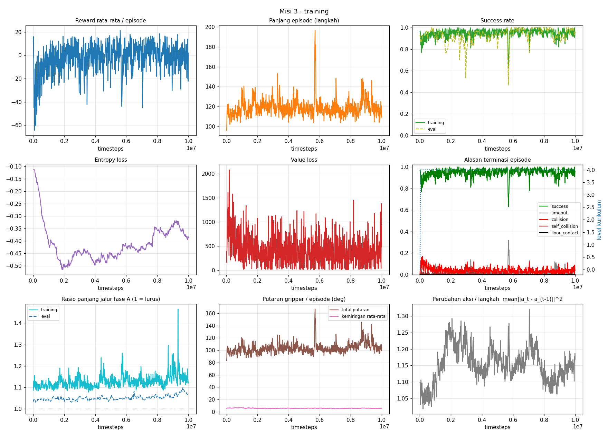
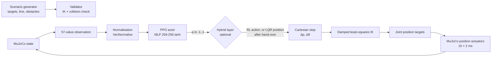

# Curriculum PPO for a UR10e Robot Arm in MuJoCo

**Proximal Policy Optimization (PPO) + inverse kinematics, trained through a curriculum of reaching, path-following
and obstacle-avoidance missions, with an optional RL + LQR hybrid controller for millimetre precision.**

 
 



---

## Abstract

This project trains a 6-DoF **Universal Robots UR10e** arm with a custom parallel gripper in the **MuJoCo** physics
simulator to solve three manipulation tasks of increasing difficulty. The policy is learned with **Proximal Policy
Optimization** (Stable-Baselines3) and acts in Cartesian space: every action is a small change of the tool pose,
converted to joint targets by a damped-least-squares **inverse-kinematics** (IK) solver.

The three missions are trained one after another, and each starts from the weights of the previous one
(**curriculum + transfer learning**): (1) reaching a random target with an adaptive precision curriculum from 10 cm
down to **5 mm**, (2) reaching a start point and following a straight line, and (3) following the line through a
"constellation" of point obstacles (the *stargaze* concept) with a five-level difficulty curriculum. A unified
57-value observation lets the weights transfer directly, and a protected transfer procedure (zeroed new inputs,
frozen normalisation, critic warm-up) keeps the transferred policy from collapsing.

The current models use the **v2 reward design** (penalties on sideways motion, gripper tilt, rotation effort and
jerk, and a failure penalty proportional to the remaining time). On 200 unseen test scenarios they reach
**98.5 %** at 5 mm (Mission 1), **97.0 %** (Mission 2) and **97.0 %** (Mission 3) with the RL policy alone. An optional
hybrid layer hands the final approach and the line to an **LQR** controller identified from the closed-loop arm
dynamics; it raises precision without retraining. All numbers and the evaluation protocol are in
[Results](#6-results).

---

## Table of contents

1. [Highlights](#1-highlights)
2. [System overview](#2-system-overview)
3. [The missions](#3-the-missions)
4. [Method and mathematics](#4-method-and-mathematics)
5. [Evaluation protocol](#5-evaluation-protocol)
6. [Results](#6-results)
7. [Parameters and hyperparameters](#7-parameters-and-hyperparameters)
8. [Project structure and the role of each script](#8-project-structure-and-the-role-of-each-script)
9. [Installation and usage](#9-installation-and-usage)
10. [The RL + LQR hybrid controller (optional)](#10-the-rl--lqr-hybrid-controller-optional)
11. [Deployment notes (sim-to-real)](#11-deployment-notes-sim-to-real)
12. [Limitations](#12-limitations)
13. [Development history](#13-development-history)
14. [Reproducibility](#14-reproducibility)
15. [Troubleshooting](#15-troubleshooting)
16. [Acknowledgements, license, security and citation](#16-acknowledgements-license-security-and-citation)

---

## 1. Highlights

| | |
|---|---|
| **Robot** | UR10e (MuJoCo Menagerie kinematics and dynamics) + a parallel gripper designed by the repository owner |
| **Simulator** | MuJoCo 3, 2 ms physics step, 20 ms control step (10 sub-steps) |
| **Algorithm** | PPO (Stable-Baselines3), MLP 256-256 with tanh activations, state-independent Gaussian policy |
| **Action space** | 6-D, normalised to [−1, 1]: tool translation (≤ 5 cm/step) + tool rotation (≤ 0.08 rad/step) → IK → joint targets |
| **Observation** | One fixed **57-value** layout for all missions, so weights transfer directly |
| **Curriculum** | Adaptive precision threshold (Mission 1, 7 levels), obstacle difficulty (Mission 3, 5 levels), weight transfer between missions |
| **Reward design (v2)** | Dense progress shaping + penalties on sideways motion, tilt, rotation effort and jerk; failure penalty that grows with the remaining time |
| **Optional controller** | RL + LQR hybrid (LQR designed from an identified ARX model of the arm), optional gripper-to-path alignment |
| **Export** | ONNX with observation normalisation baked in, versioned and verified against the PyTorch policy |
| **Tools** | MuJoCo viewer, offscreen video (Colab), interactive Meshcat/Drake HTML replay, training-resume |

---

## 2. System overview



**Control loop (every 20 ms).**
1. The environment builds the 57-value observation from the robot state, the active target, the line and the obstacles.
2. The PPO actor outputs an action in [−1, 1]⁶ (deterministic mean at evaluation time).
3. Optionally, the hybrid layer replaces the position part of the action with an LQR command near T1 and on the line.
4. The tool-pose change is converted into joint targets by IK, limited to 0.25 rad per step.
5. MuJoCo integrates 10 physics steps of 2 ms with position-controlled, gravity-compensated actuators.
6. Reward and termination are computed; self-collision, floor contact and obstacle collision end the episode.

At every reset the scenario is validated with the same IK and collision model: the target must be reachable, and a
straight (or, if blocked, polar) approach route and the line T1 → T2 must be collision-free. This guarantees that every
training and test scenario is solvable.

---

## 3. The missions

Each mission is trained by its own script (`python MissionN/train_missionN.py`, no command-line arguments), and
Mission *N+1* loads the weights of Mission *N* through the `transfer` block of its `ppo_config.yaml`.

| Mission | Task | What is new | Success criterion | Episode limit |
|---|---|---|---|---|
| **1. Reaching** | Move the tool centre point (TCP) to a random target | Adaptive precision curriculum 10 → 8 → 6 → 4 → 2 → 1 → **0.5 cm** | TCP within the current threshold (final: 5 mm) | 200 steps (4 s) |
| **2. Path following** | Reach start point T1, then follow the straight line T1 → T2 (0.15–0.50 m) | Phase flag, line features, cross-track penalty | Reach T2 within 2 cm | 300 steps |
| **3. Obstacle avoidance** | As Mission 2, through a constellation of point obstacles | Obstacle features (4 nearest obstacles), potential-based shaping, collision = −100, 5 difficulty levels | Reach T2 within 2 cm without touching an obstacle | 350 steps |

### 3.1 Mission 1 — reaching with an adaptive threshold
Targets are drawn in a ring around the robot (radius 0.35–0.48 m, height 0.25–0.45 m above the base, any azimuth). The
success threshold starts at 10 cm and tightens to the next level when the success rate over the last 100 episodes
reaches 85 % (at least 100 episodes per level, checked every 50 episodes). Only the success bonus grows with the level
($`10 \cdot 1.2^{\ell}`$), so the dense reward terms keep the same scale. An optional *workspace schedule* can also widen
the target region during the first levels (off by default, see `PERBAIKAN_V2.md`).

### 3.2 Mission 2 — reaching and line following
Phase 0 reaches T1 (within 2 cm), phase 1 follows the segment T1 → T2. The observation adds the phase flag, the line
direction, the vector from the TCP to the closest point on the line and the progress along it.

### 3.3 Mission 3 — obstacle avoidance (stargaze constellation)
T2 is the *nucleus* of a constellation: three nested cubes (half-sizes 0.1/0.2/0.3 m), each face divided into a 3×3
grid with 3–5 obstacle spheres (radius 1.5 cm) per face. T1 is chosen on the outer cube so that the line T1 → T2 keeps
at least 8 cm from every obstacle (the *stargaze* max-clearance idea). The validator rolls the reference route out
through IK and removes obstacles that the robot body would sweep through, so every scenario is solvable. The bottom face
is forbidden (floor). A 5-level curriculum shrinks the obstacle-free corridor around the route from 12 cm to 1 cm and
widens the reachable start region.

---

## 4. Method and mathematics

### 4.1 Markov decision process

The task is an episodic MDP $`(\mathcal{S}, \mathcal{A}, P, r, \gamma)`$ with $`\gamma = 0.995`$ and a control period
$`\Delta t = 20`$ ms.

**Action.** $`a \in [-1,1]^6`$, $`a = [a_p, a_\theta]`$. The commanded tool motion is

```math
\Delta p = a_p \, \Delta p_{\max}, \qquad \Delta\theta = a_\theta \, \Delta\theta_{\max},
\qquad \Delta p_{\max} = 0.05\ \text{m},\quad \Delta\theta_{\max} = 0.08\ \text{rad}.
```

The target orientation is integrated in the world frame, $`q^{\ast}_{t+1} = \exp(\Delta\theta) \otimes q^{\ast}_t`$, and
kept inside a cone of 30° around the home orientation so the IK problem stays well-posed. The IK solution is limited to
$`|q_{\text{cmd}} - q| \le 0.25`$ rad per joint per step. Gaussian samples outside [−1, 1] are clipped by the environment.

**Observation (57 values, identical layout in every mission).** Fields not used by a mission are held constant, and
sensor noise ($`\sigma = 0.005`$) is added during training only to the fields that are active in that mission
(noise on inactive fields would be normalised into random N(0, 1) inputs and break the transfer).

| Field | Size | Meaning | Active from |
|---|---|---|---|
| `rel_target` | 3 | active target − TCP position (m) | 1 |
| `q`, `qd` | 6 + 6 | joint angles and velocities | 1 |
| `tcp_pos` | 3 | TCP position relative to the base | 1 |
| `tcp_rot6` | 6 | first two columns of the TCP rotation matrix (continuous 6-D rotation representation) | 1 |
| `manip` | 1 | manipulability $`w = \sqrt{\det(J_p J_p^\top)}`$ (singularity indicator) | 1 |
| `prev_action` | 6 | previous action | 1 |
| `time_left` | 1 | $`1 - t/T_{\max}`$ | 1 |
| `phase` | 1 | 0 = reaching T1, 1 = following T1 → T2 | 2 |
| `path_dir` | 3 | unit vector T1 → T2 | 2 |
| `cross_track_vec` | 3 | vector TCP → closest point on the segment | 2 |
| `path_progress` | 1 | projection of the TCP on the segment, 0…1 | 2 |
| `obs_rel` | 12 | vectors from the closest robot point to the 4 nearest obstacles | 3 |
| `obs_dist` | 4 | surface distances to those obstacles, clipped to 0…1 m | 3 |
| `min_clearance` | 1 | minimum clearance of the whole robot body (10 capsules) | 3 |

**Normalisation.** A running mean and variance (`VecNormalize`) gives
$`\hat{o} = \mathrm{clip}\big((o-\mu)/\sqrt{\sigma^2+\epsilon},\,-10,\,10\big)`$; after a transfer the statistics are frozen.

### 4.2 Inverse kinematics (damped least squares)

For the target pose $`(p^{\ast}, q^{\ast})`$ the solver iterates from the current joint state:

```math
e = \begin{bmatrix} p^{\ast} - p(q) \\ w_r\,\mathrm{Log}\!\left(q^{\ast} \otimes q(q)^{-1}\right) \end{bmatrix},\qquad
\Delta q = J_w^\top \left(J_w J_w^\top + \lambda^2 I\right)^{-1} e_w ,
```

with rotation weight $`w_r = 0.5`$, a step limit of 0.3 rad, up to 60 iterations, and tolerances of 0.1 mm and
0.002 rad. The damping grows near singularities:

```math
\lambda = \lambda_{\min} + (\lambda_{\max} - \lambda_{\min})\,\mathrm{clip}\!\left(1 - \frac{w}{w_0},\,0,\,1\right),
\qquad \lambda_{\min}=10^{-4},\quad \lambda_{\max}=0.05,\quad w_0 = 0.02 .
```

The result is clamped to the joint limits and unwrapped to the solution closest to the current configuration. Each
iteration only updates kinematics (not full dynamics), and the 0.1 mm tolerance is far below the 5 mm task threshold.

### 4.3 Reward functions

With $`d_t`$ the distance from the TCP to the active target, all missions share these dense terms (v2 design):

```math
r^{\text{common}}_t =
\underbrace{-0.02}_{\text{time}}
\;\underbrace{-\,0.5\,d_t}_{\text{distance}}
\;+\;\underbrace{20\,(d_{t-1}-d_t)}_{\text{progress}}
\;\underbrace{-\,0.1\,\min\!\big(\|a_t-a_{t-1}\|^2,\,1\big)}_{\text{smoothness}}
\;\underbrace{-\,20\,\|\Delta p_{\perp}\|}_{\text{sideways motion}}
\;\underbrace{-\,1.0\,\vartheta_t^2}_{\text{tilt}}
\;\underbrace{-\,0.05\,\|a_{\theta,t}\|^2}_{\text{rotation effort}}
```

* $`\Delta p_{\perp}`$ is the component of the TCP step perpendicular to the direction towards the target. Progress
  shaping is telescopic (a curved path earns the same total as a straight one), so without this term detours are almost free.
* $`\vartheta_t`$ is the tilt of the gripper from its nominal orientation. The missions contain no orientation task, so
  without the tilt and rotation-effort terms the rotation actions received no signal and saturated at the 30° cone.
* The smoothness term is capped at 1 per step so that early exploration noise cannot dominate the reward.

**Failure penalty.** A contact or collision ends the episode with

```math
r_{\text{fail}} = r_{\text{base}} - c\,(T_{\max} - t), \qquad c = 1.0 ,
```

with $`r_{\text{base}} = -10`$ (self/floor contact) or $`-100`$ (obstacle collision). Without the remaining-time term,
crashing early was cheaper than continuing a poor episode, and policies learned to hit the floor on purpose.

| Mission | Additional terms |
|---|---|
| 1 | success $`+10 \cdot 1.2^{\ell}`$ (curriculum level $`\ell`$) |
| 2 | phase change $`+5`$; cross-track $`-150\,\min(d_\perp, 0.08)^2`$; success $`+20`$ |
| 3 | as Mission 2 with success $`+40`$; obstacle collision (failure penalty above); obstacle shaping (below) |

**Potential-based obstacle shaping (Mission 3).** With $`c`$ the minimum robot–obstacle clearance,

```math
\Phi(c) = \begin{cases} -k\left(\dfrac{1}{c+\varepsilon} - \dfrac{1}{d_{\text{safe}}+\varepsilon}\right), & c < d_{\text{safe}} \\[4pt] 0, & \text{otherwise} \end{cases}
\qquad\qquad F_t = \gamma\,\Phi(c_{t+1}) - \Phi(c_t),
```

with $`k = 0.3`$, $`\varepsilon = 0.01`$ m, $`d_{\text{safe}} = 0.12`$ m. Potential-based shaping leaves the optimal
policy unchanged (Ng et al., 1999); the earlier per-step penalty made standing still near an obstacle cheaper than
moving (timeouts rose from 18 % to 69 % when the corridor was widened).

### 4.4 Proximal Policy Optimization

The policy is a Gaussian $`\pi_\theta(a|s) = \mathcal{N}(\mu_\theta(s), \mathrm{diag}(\sigma^2))`$ with a learned,
state-independent $`\log\sigma`$, and a separate value network $`V_\phi(s)`$ (both MLP 256-256, tanh). Rollouts of
$`n_{\text{steps}} \times n_{\text{envs}}`$ transitions are collected, advantages are estimated with GAE,

```math
\delta_t = r_t + \gamma V_\phi(s_{t+1})(1-d_{t+1}) - V_\phi(s_t),\qquad
\hat A_t = \sum_{l\ge 0} (\gamma\lambda)^l\, \delta_{t+l},\qquad \lambda = 0.95,
```

and the network is updated for several epochs of mini-batches on the clipped surrogate objective

```math
L(\theta,\phi) = \mathbb{E}_t\Big[\min\big(\rho_t \hat A_t,\ \mathrm{clip}(\rho_t, 1-\epsilon, 1+\epsilon)\,\hat A_t\big)\Big]
- c_v\, \mathbb{E}_t\big[(V_\phi(s_t) - \hat R_t)^2\big] + c_e\, \mathbb{E}_t\big[\mathcal{H}(\pi_\theta(\cdot|s_t))\big],
\qquad \rho_t = \frac{\pi_\theta(a_t|s_t)}{\pi_{\theta_{\text{old}}}(a_t|s_t)},
```

with clip range $`\epsilon`$ (0.15–0.2), value coefficient $`c_v = 0.5`$ and entropy coefficient $`c_e`$ (0–0.003).
Advantages are normalised per mini-batch, gradients are clipped to norm 0.5, and an epoch loop stops early when the
approximate KL divergence exceeds `target_kl` (0.02–0.03).

### 4.5 Curriculum and protected transfer learning

* **Adaptive threshold (Mission 1).** Level $`\ell`$ uses $`\delta_\ell \in \{10, 8, 6, 4, 2, 1, 0.5\}`$ cm; advance
  when the success rate over a 100-episode window reaches 85 % (checked every 50 episodes, at least 100 episodes per
  level; the window is cleared on every advance so levels cannot cascade).
* **Difficulty levels (Mission 3).** Same rule with an 80 % threshold; the corridor around the route shrinks
  12 → 8 → 5 → 3 → 1 cm, the approach corridor 20 → 15 cm, and the reach limits of T1 widen. The 15 cm approach
  corridor at the final level is part of the task definition: the policy's own approach path deviates 5–20 cm from the
  reference route, which it cannot observe.
* **Weight transfer.** All missions share the network shape and observation, so Mission *N*'s weights load directly.
  Without protection, fine-tuning Mission 2 dropped success from 75 % to 0 % within 25k steps. The protection is:
  1. first-layer weights of newly active inputs set to zero (the transferred policy initially ignores them);
  2. normalisation statistics frozen; statistics of the new inputs estimated from 8000 real observations;
  3. the action standard deviation kept from the previous mission (Mission 2 additionally caps it at 0.25; Mission 3
     resets it to 0.25 to give room for avoidance behaviour);
  4. **critic warm-up**: the actor is frozen for the first 100–150k steps and only the value network learns, because
     advantages from an untrained critic destroyed the transferred policy in a single update.
* **Model selection.** `best_model` is chosen lexicographically by (curriculum level, success rate, precision) on a
  fixed set of evaluation scenarios; mean reward is not used because its scale changes with the curriculum.

### 4.6 Scenario generation and validation

Every reset draws a scenario and checks it with the same IK and collision geometry the environment uses, rejecting
it when the target is unreachable or when the approach route (straight, or polar around the base if the straight line
hits the robot) self-collides or touches the floor. Robot–obstacle clearance is computed from 10 capsules covering the
arm, not from link origins. In Mission 3 the start point follows the stargaze rule:

```math
C(S) = \min_i \Big(\mathrm{dist}\big(p_i,\ \overline{SN}\big) - r_i\Big),\qquad
S \in \{\,S : C(S) \ge 0.08\ \text{m}\,\}\ \ (\text{random among safe candidates}),
```

where $`N`$ is the nucleus (T2), $`p_i`$ the obstacle centres and $`r_i`$ their radii; candidates lie on the outer-cube
faces facing the robot and its neighbours (the opposite face and the bottom face are excluded).

---

## 5. Evaluation protocol

* **Held-out scenarios.** The numbers in [Results](#6-results) come from 200 scenarios per mission (seeds 600000+)
  that were never used during training or model selection. Each mission is evaluated on its **final** task: 5 mm for
  Mission 1, 2 cm for Mission 2, and the last curriculum level (1 cm corridor) for Mission 3.
* **Baseline.** A straight-line reference controller (`make_predict_fn_scripted`) runs on the same scenarios: it
  follows the validated approach route with a proportional law
  $`a_p = \mathrm{sat}_1\big(0.8\,(p_{\text{tgt}} - p)/\Delta p_{\max}\big)`$ and does not rotate the gripper. It shows
  how hard each task is and what a trivial controller achieves.
* **Confidence interval.** 95 % Wilson score interval for $`\hat p = k/n`$:
  ```math
  \frac{\hat p + \frac{z^2}{2n} \pm z\sqrt{\frac{\hat p(1-\hat p)}{n} + \frac{z^2}{4n^2}}}{1 + \frac{z^2}{n}},\qquad z = 1.96 .
  ```
  With 200 scenarios a 90 % result has an interval of about ±4 points; 10 scenarios would give about ±20.
* **Conditions.** *Final task*: nominal dynamics, no sensor noise. *DR + noise*: payload +0–1 kg, gravity ×0.98–1.02,
  and observation noise σ = 0.005.
* **Hybrid benchmark.** `benchmark_hybrid_missionN.py` compares RL alone, RL + LQR, and RL + LQR + orientation on 100
  fixed scenarios (seeds 20000+) at 2 cm and 5 mm.
* **ONNX check.** Every exported model is compared with the PyTorch actor on real observations (tolerance 1e-4).

---

## 6. Results

All numbers were measured on the models shipped in `checkpoints/` and `models/` (v2 reward design), with the script
`_readme_eval/eval_all.py` and the two benchmark scripts.

### 6.1 Training summary

| Mission | Best model at | Final curriculum level | Training-time evaluation of the best model |
|---|---|---|---|
| 1. Reaching | 6.3 M steps | 6 of 6 (5 mm) | 100 % of 50 episodes, final distance 3.5 mm |
| 2. Path following | 7.15 M steps | — | 100 % of 30 episodes, mean cross-track 18.7 mm |
| 3. Obstacle avoidance | 5.6 M steps | 4 of 4 (1 cm corridor) | 100 % of 30 episodes, cross-track 20.0 mm, min. clearance 18 mm |

Curriculum progress: Mission 1 advanced 10 cm → 8 cm at 0.29 M, → 6 cm at 0.32 M, → 4 cm at 0.39 M, → 2 cm at 0.44 M,
→ 1 cm at 0.92 M and → 5 mm at 1.15 M steps; Mission 3 reached its final level within the first 43k steps of its run.

### 6.2 Held-out test: RL policy vs straight-line reference (200 unseen scenarios each)

| Mission (final task) | Condition | Reference: success (95 % CI) | RL policy: success (95 % CI) | Steps to success (ref → RL) | Cross-track on the line (ref / RL) | RL failures |
|---|---|---|---|---|---|---|
| 1 — reach, 5 mm | nominal | 90.0 % (85–93) | **98.5 % (96–99)** | 104.5 → **88.9** | — | 3 timeouts |
| 1 — reach, 5 mm | DR + noise | 94.5 % (90–97) | **100 % (98–100)** | 108.2 → **90.8** | — | none |
| 2 — line, 2 cm | nominal | 100 % (98–100) | 97.0 % (94–99) | 143.6 → **111.3** | 8.1 / 21.1 mm | 6 timeouts |
| 2 — line, 2 cm | DR + noise | 100 % (98–100) | 98.5 % (96–99) | 139.1 → **111.6** | 8.0 / 19.9 mm | 3 timeouts |
| 3 — obstacles, 2 cm | nominal | 99.5 % (97–100) | 97.0 % (94–99) | 147.8 → **114.7** | 7.4 / 20.1 mm | 5 collisions, 1 timeout |
| 3 — obstacles, 2 cm | DR + noise | 99.0 % (96–100) | 95.0 % (91–97) | 143.5 → **110.4** | 7.6 / 21.4 mm | 7 collisions, 2 timeouts, 1 self-collision |

* **Mission 1:** the RL policy beats the reference at the 5 mm task (98.5 % vs 90.0 %, non-overlapping intervals) and is
  15 % faster. The reference's failures are timeouts where proportional control stalls just outside 5 mm.
* **Missions 2–3:** the RL policy solves 95–98.5 % of the scenarios and is **22–25 % faster** than the reference, but
  follows the line less tightly (about 20 mm vs 8 mm mean cross-track; the success criterion is 2 cm at T2). The
  reference has an advantage it cannot have on a real robot: it follows the pre-validated, obstacle-free route.
* Domain randomisation and sensor noise change the results by at most 2 points, within the confidence intervals.

### 6.3 Trajectory quality of the v2 models

Measured by the training-time evaluation of each best model (`best_model_info.json`):

| Mission | Path length ÷ straight distance (phase A) | Gripper rotation per episode | Mean tilt | Action change per step |
|---|---|---|---|---|
| 1 | 1.09 | 38.3° | 5.5° | 0.12 |
| 2 | 1.04 | — | — | — |
| 3 | 1.05 | — | — | — |

For comparison, the previous (v1) models measured 1.16–1.26 path ratio, 115–132° of rotation per episode, rotation
actions saturated at |a| ≈ 0.9, and gripper tilts up to the 30° limit (see `PERBAIKAN_V2.md`).

### 6.4 Hybrid controller benchmark (100 fixed scenarios, seeds 20000+)

| Mission | Threshold | RL alone | RL + LQR (position) | RL + LQR + alignment | Cross-track (RL → RL + LQR) | Steps (RL → RL + LQR) |
|---|---|---|---|---|---|---|
| 2 | 2 cm | 96 % (90–98) | **99 % (95–100)** | 97 % (92–99) | 20.0 → **2.3 mm** | 113.6 → 109.4 |
| 2 | 5 mm | 14 % (9–22) | **99 % (95–100)** | 97 % (92–99) | 29.2 → **1.5 mm** | 278.0 → 120.1 |
| 3 | 2 cm | 95 % (89–98) | **99 % (95–100)** | 95 % (89–98) | 21.1 → **1.6 mm** | 106.1 → 112.2 |
| 3 | 5 mm | 31 % (23–41) | **99 % (95–100)** | 95 % (89–98) | 19.2 → **1.2 mm** | 272.3 → 122.9 |

* **At 5 mm the LQR hand-over is what makes the task solvable**: RL alone mostly times out (it was trained for 2 cm),
  while RL + LQR reaches 99 % in both missions with about 1–2 mm cross-track. At 2 cm it adds 3–4 points.
* The single remaining hybrid failure in each mission is a self-collision during the RL-controlled approach.
* **Gripper alignment** reduces the mean angle between gripper axis and path on steep downward paths from 36° to
  1.5–1.6° (99–100 % of the steps below 10°; 22 such paths in Mission 2, 47 in Mission 3), but with the v2 models it
  costs 2–4 points of success (paired comparison: alignment never better on any scenario, worse on 2 and 4). Keep it off
  unless the gripper orientation is required by the task.
* Compared with the v1 models (Mission 3 at 5 mm: 4 % → 81 % with LQR), the v2 policy approaches T1 more cleanly, so
  the hybrid reaches 99 %.

### 6.5 Discussion

* **Precision.** The v2 Mission 1 policy reaches the 5 mm target alone; the straight-line reference stalls short of it
  in some configurations. For Missions 2–3 the policy was trained on a 2 cm task; at 5 mm the LQR hand-over supplies the
  missing precision.
* **Obstacles.** The validated route already avoids the obstacles, so a trivial route-follower is a strong baseline in
  Mission 3; the learned policy chooses its own path, and its remaining failures are mostly collisions or contacts on
  that path. The hybrid controller does not avoid obstacles.
* **Motion quality.** The v2 reward terms produce near-straight, low-jerk motion with small gripper tilt, which the old
  design did not.

---

## 7. Parameters and hyperparameters

Every parameter lives in YAML; there are no command-line arguments. Each mission has three files:
`ppo_config.yaml` (training), `domain_randomization.yaml` (environment) and `eval_config.yaml` (evaluation).
The hybrid controller is configured in `shared/control/controller.yaml`.

### 7.1 PPO (`MissionN/configs/ppo_config.yaml` → `ppo:`)

| Parameter | M1 | M2 | M3 | Role |
|---|---|---|---|---|
| `learning_rate` | 3e-4 | 1e-4 | 1.5e-4 | Adam step size. Small when fine-tuning (2e-4 damaged the transferred Mission 2 policy) |
| `n_steps` | 1024 | 1024 | 2048 | Steps per environment per rollout; batch = `n_steps × n_envs` (4096 / 4096 / 8192) |
| `batch_size` | 512 | 512 | 1024 | Mini-batch size for each gradient step |
| `n_epochs` | 8 | 5 | 5 | Passes over each rollout |
| `gamma` | 0.995 | 0.995 | 0.995 | Discount factor: horizon ≈ 1/(1−γ) = 200 steps (4 s) |
| `gae_lambda` | 0.95 | 0.95 | 0.95 | GAE bias–variance trade-off |
| `clip_range` | 0.2 | 0.15 | 0.2 | PPO trust-region size $`\epsilon`$; smaller = more conservative updates |
| `ent_coef` | 0.003 | 0.0 | 0.003 | Entropy bonus $`c_e`$: exploration. Zero in Mission 2 so the action noise can shrink for precision |
| `vf_coef` | 0.5 | 0.5 | 0.5 | Weight of the value loss |
| `max_grad_norm` | 0.5 | 0.5 | 0.5 | Gradient clipping |
| `target_kl` | 0.03 | 0.02 | 0.03 | Stops the epoch loop when the policy moves too far |
| `log_std_init` | −0.5 | (kept) | (transfer: −1.4) | Initial log std of the actions (σ = 0.6; SB3's default 1.0 clipped many actions at ±1) |
| `net_arch`, `activation_fn` | [256, 256], tanh | same | same | Must be identical in all missions for weight transfer |

### 7.2 Run, evaluation, resume and export

| Parameter | Value | Role |
|---|---|---|
| `run.timesteps` | 7.5 M (M1, M2), 10 M (M3) | Total environment steps (with `resume`: additional steps) |
| `run.n_envs`, `vec_env` | 4, `auto` | Parallel environments (subprocesses when > 1) |
| `run.seed` | 4 / 5 / 6 | Random seed (environments use seed + 1000·i) |
| `run.eval_freq`, `eval_episodes`, `eval_seed` | 100k/50 (M1), 50k/30 (M2–3), 424242 | Periodic deterministic evaluation on fixed scenarios → `best_model.zip` |
| `run.ckpt_freq` | 2.5 M / 0.1 M / 5 M | Periodic checkpoints (model + normalisation) |
| `resume.enabled`, `model`, `vecnormalize`, `curriculum_state` | false | Continue an interrupted run: model, normalisation and curriculum level are restored; transfer and warm-up are skipped |
| `normalization.clip_obs`, `epsilon`, `norm_reward` | 10, 1e-8, false | Observation normalisation; rewards are not normalised |
| `export.source`, `verify_tolerance` | `best`, 1e-4 | Which model becomes ONNX and the allowed ONNX vs PyTorch difference |
| `debug.*` | sanity checks 20 IK targets, 10 resets, 10 scripted episodes | Pre-training checks and post-training plots |

### 7.3 Transfer (`transfer:`, Missions 2–3)

| Parameter | M2 | M3 | Role |
|---|---|---|---|
| `source_model`, `source_vecnormalize` | Mission 1 `best_*` | Mission 2 `best_*` | Weights and normalisation to start from |
| `zero_new_input_weights` | true | true | Zero the first-layer weights of newly active inputs |
| `freeze_obs_rms` | true | true | Keep normalisation statistics fixed |
| `warm_stats_steps`, `obs_rms_count` | 8000, 50 000 | 8000, 50 000 | Real observations used for new-input statistics; pseudo-count so they do not jump |
| `critic_warmup_steps` | 150 000 | 100 000 | Actor frozen, value network only |
| `log_std_init` | null (kept) | −1.4 (σ = 0.25) | Reset of the action standard deviation |
| `log_std_max` | −1.386 (σ ≤ 0.25) | — | Upper bound on the action standard deviation |

### 7.4 Environment (`domain_randomization.yaml`)

| Parameter | Value | Role |
|---|---|---|
| `action.max_pos_delta` | 0.05 m | Tool translation per step at action 1 |
| `action.max_rot_delta` | 0.08 rad | Tool rotation per step at action 1 |
| `action.max_joint_delta` | 0.25 rad | Joint target change limit per step |
| `action.max_orientation_dev_deg` | 30° | Orientation cone around the home orientation |
| `physics.n_substeps` | 10 | Physics steps per control step (2 ms × 10 = 20 ms) |
| `physics.gravity_compensation` | true | Nominal gravity compensation; without it the arm sagged ~10 mm and 5 mm was unreachable |
| `ik.*` | 60 iterations, 0.1 mm, 0.002 rad, rotation weight 0.5 | IK solver settings (Section 4.2) |
| `robot_dynamics.payload_mass_range` | 0–1 kg | Random extra gripper mass (domain randomisation) |
| `robot_dynamics.gravity_scale_range` | 0.98–1.02 | Random gravity scale, partially uncompensated |
| `randomization.init_joint_noise` | 0.05 rad | Random initial pose around home (training only) |
| `randomization.obs_noise_std` | 0.005 | Sensor noise on active continuous observations (training only) |
| `workspace.*` | r 0.35–0.48 m, h 0.25–0.45 m, any azimuth | Mission 1–2 target region |
| `episode.max_steps` | 200 / 300 / 350 | Time limit per mission |
| `episode.success_pos_threshold` | 0.10 → 0.005 (M1, curriculum), 0.02 (M2–3) | Success distance |
| `path_task.t1_reach_threshold` | 0.02 m | Distance to T1 that switches to the line phase |
| `path_task.cross_track_cap` | 0.08 m | Cross-track error is capped inside the penalty so returns and value loss cannot explode |
| `path_task.segment_length_range` | 0.15–0.50 m | Length of T1 → T2 (Mission 2) |
| `safety.terminate_on_contact` | true | End the episode on self-collision or floor contact |
| `validation.*` | 40 attempts, 2 mm, 4 cm waypoints; M3: corridor 0.01 m, approach 0.15 m | Scenario validation (Mission 3 values = final curriculum level) |

### 7.5 Reward weights (`reward:`)

| Parameter | Value | Role |
|---|---|---|
| `time_penalty` | −0.02 | Encourages finishing quickly |
| `distance_penalty` | 0.5 | Dense pull towards the target |
| `progress_weight` | 20 | Reward per metre of progress (symmetric shaping) |
| `smoothness_penalty`, `smoothness_cap` | 0.1, 1.0 | Penalty on action changes, capped per step |
| `lateral_motion_penalty` | 20 | Penalty per metre of sideways TCP motion (v2) |
| `orientation_penalty` | 1.0 | Penalty on squared gripper tilt (v2) |
| `rotation_effort_penalty` | 0.05 | Penalty on rotation actions (v2) |
| `path_length_penalty` | 0 | Alternative that also penalises forward motion (experiments only) |
| `failure_penalty_per_remaining_step` | 1.0 | Makes crashing never cheaper than continuing (v2) |
| `contact_penalty` | −10 | Base penalty for self/floor contact |
| `success_reward` | 10 (× 1.2^level, M1), 20 (M2), 40 (M3) | Terminal bonus |
| `cross_track_penalty` | 150 | Weight of the squared distance to the line |
| `phase_transition_bonus` | 5 | Bonus for reaching T1 |
| `collision_penalty` | −100 (M3) | Base penalty for obstacle collision |
| `obstacle_mode`, `obstacle_potential_k`, `obstacle_eps`, `d_safe`, `obstacle_gamma` | potential, 0.3, 0.01, 0.12 m, 0.995 | Potential-based obstacle shaping (Section 4.3) |
| `approach_track_penalty` | 0 | Optional penalty on deviating from the reference approach route (off) |

### 7.6 Curriculum (`adaptive:` / `curriculum:`)

| Parameter | Value | Role |
|---|---|---|
| `adaptive.thresholds` | [0.10, 0.08, 0.06, 0.04, 0.02, 0.01, 0.005] m | Mission 1 precision levels; the last one is the final task |
| `adaptive.success_rate_to_advance` | 0.85 | Success rate needed to advance |
| `adaptive.reward_success_multiplier` | 1.2 | Growth of the success bonus per level |
| `adaptive.workspace_schedule` | off | Optional widening of the target region in the first levels |
| `curriculum.advance_success_rate` | 0.80 | Mission 3 success rate needed to advance |
| `check_every_n_episodes`, `window_episodes`, `warmup_episodes` | 50, 100, 100 | How often, over how many episodes, and after how many episodes per level the rule is checked |
| `curriculum.levels` | corridor 0.12 → 0.01 m, approach 0.20 → 0.15 m, reach limits r ≤ 0.52 → 0.70 m, z ≤ 0.72 → 0.88 m, then free | Mission 3 difficulty schedule |

### 7.7 Mission 3 obstacles (`mission3:`)

| Parameter | Value | Role |
|---|---|---|
| `constellation_L_values` | [0.1, 0.2, 0.3] m | Half-sizes of the three nested cubes |
| `constellation_grid_size`, `constellation_n_points_per_face_range` | 3, 3–5 | 3×3 grid per face; obstacles per face |
| `constellation_jitter`, `constellation_min_radius` | 0.35, 0.08 m | Random offset inside a grid cell; minimum distance from the nucleus |
| `obstacle_radius`, `d_safe` | 0.015 m, 0.12 m | Obstacle sphere radius; shaping distance |
| `min_line_clearance` | 0.08 m | Minimum clearance of the line T1 → T2 |
| `start_selection`, `initial_face`, `forbidden_faces` | random_safe, auto, [−z] | How T1 is chosen; faces allowed |
| `home_keepout`, `max_prune_fraction`, `min_obstacles` | 0.06 m, 0.6, 6 | Obstacle pruning near the home pose and limits of the repair step |

### 7.8 Hybrid controller (`shared/control/controller.yaml`)

| Parameter | Value | Role |
|---|---|---|
| `controller.law` | `lqr` | `lqr` or `p` (proportional) |
| `q_e_cross`, `q_v_cross`, `q_e_along`, `q_v_along`, `r` | 1115, 6337, 27.1, 701, 4.52 | LQR weights across and along the line (tuned on 40 scenarios, validated on 60 others) |
| `kp` | 0.4 | Gain for `law: p` |
| `lead_approach`, `lead_line` | 0.25 m, 0.03 m | Carrot distance ahead of the TCP (approach) and of its projection (line) |
| `v_cruise`, `taper_gain` | 0.004 m/step, 0.25 | Cruise speed on the line and slow-down before T2 |
| `hybrid.handover_distance` | 0.08 m | Distance to T1 at which the LQR takes over position (4–15 cm gave identical results) |
| `hybrid.blend_steps` | 0 | Blending steps at hand-over (5–15 had no effect) |
| `orientation.enabled` | false | Gripper-to-path alignment (steep downward paths only) |
| `orientation.gate_angle_deg`, `start_distance`, `k_rot`, `lead_max_deg`, `hold_until_deg` | 60°, 0.40 m, 0.3, 15°, 10° | Alignment gate, hand-over distance, gain, anti-windup, hold condition |
| `benchmark.n_scenarios`, `seed_start`, `thresholds` | 100, 20000, [0.02, 0.005] | Benchmark settings |

---

## 8. Project structure and the role of each script

```
ABC_XYZbot/
├── Mission1/ … Mission3/
│   ├── envs/                    training environment (gymnasium.Env)
│   ├── eval_envs/               evaluation environment (subclass of the training env, visual robot model)
│   ├── configs/                 ppo_config.yaml · domain_randomization.yaml · eval_config.yaml
│   ├── debug/                   mission plots (replay, cross-track, obstacle clearance)
│   ├── train_missionN.py        entry point: sanity check → training → ONNX → debug plots
│   ├── eval_missionN.py         entry point: evaluation in the MuJoCo viewer (or headless)
│   └── benchmark_hybrid_missionN.py   (M2, M3) RL vs RL + LQR at 2 cm and 5 mm
├── shared/
│   ├── envs/                    base environment, observation layout, robot capsules, validation, path task
│   ├── training/                training pipeline, callbacks, transfer learning
│   ├── control/                 LQR path controller, orientation controller, hybrid policy, benchmark
│   ├── evaluation/              viewer evaluation, offscreen video, Drake/Meshcat replay
│   ├── exporter/                ONNX export, verification, versioning
│   └── debug_common/            sanity checks, rollouts, plots, TensorBoard reader
├── ik/                          damped-least-squares IK + pose utilities
├── obstacles/                   stargaze constellation generator (+ interactive visualiser)
├── robot_model/                 MJCF models (train / eval) + meshes (assets/)
├── checkpoints/                 training outputs per mission (models, plots, logs)
├── models/                      exported ONNX policies (+ JSON metadata)
├── revision_v2/                 v2 reward-design notes (PERBAIKAN_V2.md) and comparison figure
├── _readme_eval/                evaluation script + raw results behind the numbers in this README
└── requirements.txt
```

### 8.1 Entry points

| Script | Role |
|---|---|
| `MissionN/train_missionN.py` | Whole pipeline for mission N: sanity check (IK, environment, scripted controller) → PPO training with TensorBoard → `best_model` and `final_model` → versioned ONNX export → verification on real observations → debug plots. Supports `resume` |
| `MissionN/eval_missionN.py` | Evaluates the latest (or a chosen) ONNX policy in the MuJoCo viewer or headless; CSV log and replay plots; optional hybrid mode |
| `Mission2/benchmark_hybrid_mission2.py`, `Mission3/benchmark_hybrid_mission3.py` | RL alone vs RL + LQR vs RL + LQR + orientation on fixed scenarios at 2 cm and 5 mm, with Wilson CI and cross-track |
| `obstacles/stargaze_visualizer.py` | Interactive 3D tool to explore the stargaze max-clearance line |

### 8.2 Modules

| Module | Role |
|---|---|
| `shared/envs/base_arm_env.py` | Base environment: MuJoCo, IK, robot capsules, action → IK → actuators, domain randomisation, scenario-validation loop, observation, shared reward terms (v2), failure penalty |
| `shared/envs/obs_layout.py` | The 57-value observation layout, active inputs per mission, noise mask |
| `shared/envs/path_task.py` | Phase logic and rewards of Missions 2–3 |
| `shared/envs/robot_geometry.py` | Robot body as capsules; vectorised robot–obstacle clearance |
| `shared/envs/validation.py` | Reachability checker: IK rollout of straight/polar routes, contact and clearance checks |
| `MissionN/envs/stageN_*_env.py` | Mission-specific scenario sampling, validation and reward |
| `shared/training/trainer.py` | Generic training pipeline, resume, ONNX export and post-training debug |
| `shared/training/callbacks.py` | Adaptive threshold, difficulty curriculum, best-model evaluation, critic warm-up, progress and failure-reason logging |
| `shared/training/transfer.py` | Protected weight transfer between missions |
| `shared/control/path_controller.py` | LQR (or P) position controller designed from an identified ARX plant model |
| `shared/control/orientation_controller.py` | Gripper-to-path alignment with anti-windup |
| `shared/control/hybrid.py` | RL + LQR hybrid policy (`make_hybrid_from_onnx`, `bind_to_env`) |
| `shared/control/benchmark.py` | Benchmark engine used by `benchmark_hybrid_missionN.py` |
| `shared/evaluation/viewer_eval.py` | Viewer evaluation with T1/T2/line/obstacle markers |
| `shared/evaluation/video_render.py` | Offscreen MP4 rendering for Google Colab or servers (EGL/OSMesa) |
| `shared/evaluation/drake_replay.py` | Records episodes in MuJoCo and replays them as a standalone interactive Meshcat HTML (Drake) |
| `shared/exporter/to_onnx.py`, `verify_onnx.py`, `versioning.py` | ONNX export with normalisation inside the graph, verification, version numbering |
| `shared/debug_common/*` | Sanity checks, guaranteed-terminating rollouts, training curves (3×3 panels incl. trajectory quality), replays, robustness, `path_quality.png` |
| `ik/ik_solver.py`, `ik/pose_utils.py` | IK solver and quaternion / segment helpers |
| `obstacles/stargaze.py` | Headless constellation generator and start-point selection |

### 8.3 Outputs of a training run (`checkpoints/missionN/`)

| File | Content |
|---|---|
| `best_model.zip`, `best_vecnormalize.pkl` | Best model by (level, success, precision) + its normalisation statistics (used by the next mission) |
| `final_model.zip`, `final_vecnormalize.pkl` | Model at the end of training (used by `resume`) |
| `best_model_info.json`, `curriculum_state.json`, `eval_log.csv` | Best evaluation details (incl. trajectory-quality metrics), curriculum history, evaluation log |
| `tb_logs/` | TensorBoard logs (`rollout/path_ratio_A`, `rollout/rot_travel_deg`, `rollout/action_jerk`, `reasons/*`, `curriculum/level`, …) |
| `debug/` | Training curves, path quality vs straight line, replays, ONNX vs checkpoint, robustness |
| `hybrid_benchmark.csv` (M2, M3) | Per-scenario benchmark results |
| `models/onnx_missionN_vK.onnx` (+ `.json`) | Exported policy; version K increases on every export |

---

## 9. Installation and usage

### 9.1 Installation

```bash
python -m venv .venv && source .venv/bin/activate      # Python 3.10+ (tested 3.12); Windows: .venv\Scripts\activate
pip install -r requirements.txt
```

Tested with mujoco 3.14, gymnasium 1.3, stable-baselines3 2.9, torch 2.14 (CPU), numpy 2.4, onnx 1.23, onnxruntime 1.24.
A GPU is not needed. Tested on Linux and WSL; on macOS start the viewer with `mjpython`. Training models use no meshes;
`robot_model/assets/` (~40 MB) is only needed for the viewer.

### 9.2 Using the trained models

```bash
python Mission3/benchmark_hybrid_mission3.py     # RL vs hybrid, 2 cm and 5 mm (a few minutes)
python Mission2/benchmark_hybrid_mission2.py
python Mission3/eval_mission3.py                 # MuJoCo viewer
```

To reproduce the held-out numbers of Section 6.2 (200 scenarios × 3 missions × 2 conditions, about 30–60 min on CPU):

```bash
python _readme_eval/eval_all.py                  # writes _readme_eval/eval_all.json and eval_all.log
```

### 9.3 Training (run in order)

```bash
python Mission1/train_mission1.py
python Mission2/train_mission2.py      # needs checkpoints/mission1/best_model.zip + best_vecnormalize.pkl
python Mission3/train_mission3.py      # needs checkpoints/mission2/best_model.zip + best_vecnormalize.pkl
tensorboard --logdir checkpoints
```

* **Ctrl+C is safe**: the best model is saved, exported and verified. Press once and wait 1–2 minutes.
* **Resume**: set `resume.enabled: true` in `ppo_config.yaml`; `run.timesteps` then means additional steps.
* Training overwrites `best_model.zip` (ONNX files get a new version number); back up `checkpoints/` first.
* Monitor `curriculum/level`, `rollout/path_ratio_A`, `rollout/rot_travel_deg`, `rollout/action_jerk` and
  `reasons/self_collision_rate` besides the success rate.

### 9.4 Evaluation settings

`MissionN/configs/eval_config.yaml` sets the number of scenarios, seeds, thresholds, randomisation, the ONNX file
(`latest` = highest version in `models/`) and the hybrid mode. For numbers that can be compared between models, use
`viewer.enabled: false` and `rollout.n_scenarios` ≥ 100.

### 9.5 Google Colab and videos

The viewer does not run on Colab. Use `shared/evaluation/video_render.py` (offscreen MP4; set `MUJOCO_GL=egl` or
`osmesa` before importing MuJoCo) or `shared/evaluation/drake_replay.py` (interactive HTML; `pip install drake`,
Python ≥ 3.12).

---

## 10. The RL + LQR hybrid controller (optional)

The trained ONNX policy is used unchanged. Near the start point (within 8 cm of T1) or as soon as the line phase begins,
an LQR controller takes over the **position** part of the action; the rotation part stays with the RL policy. The
controller reads only the same 57-value observation, so it can be deployed next to the ONNX file.

**Plant model.** The closed-loop response of the arm to a position command was identified per axis as an ARX model
(in metres and control steps, $`u_k = a_k\,\Delta p_{\max}`$):

```math
v_k = a_1 v_{k-1} + a_2 v_{k-2} + b_0 u_k + b_1 u_{k-1},\qquad p_{k+1} = p_k + v_k ,
\qquad (a_1, a_2, b_0, b_1) = (0.9909,\ -0.2513,\ 0.0980,\ -0.0535).
```

**LQR.** With the error to a moving reference point $`e_k`$ and the state $`s_k = [e_k, v_{k-1}, v_{k-2}, u_{k-1}]^\top`$,
the gain $`K`$ minimises $`\sum_k s_k^\top Q s_k + r\,u_k^2`$ and follows from the discrete algebraic Riccati equation

```math
P = Q + A^\top P A - A^\top P B \left(R + B^\top P B\right)^{-1} B^\top P A,\qquad
K = \left(R + B^\top P B\right)^{-1} B^\top P A,\qquad u_k = u_{\text{ff}} - K s_k ,
```

with separate weights across and along the line (Section 7.8). The reference is a "carrot" point ahead of the TCP
(25 cm while approaching T1, 3 cm ahead of the projection on the line), moving along the line at 4 mm per step and
slowing before T2.

**Gripper alignment (optional).** For steep downward paths (< 60° from straight down) the controller can also rotate the
gripper so that its axis points along the path; it starts 40 cm before T1, limits the commanded rotation to 15° ahead of
the actual one, and holds the motion until the error is below 10°.

```python
from shared.control import make_hybrid_from_onnx
policy = make_hybrid_from_onnx("models/onnx_mission3_v1.onnx")   # parameters: shared/control/controller.yaml
policy.reset()                  # REQUIRED at the start of every episode (the controller keeps a position history)
action = policy(raw_obs)        # raw 57-value observation; normalisation is inside the ONNX graph
```

In the viewer evaluation set `hybrid.enabled: true` (and optionally `hybrid.orientation: true`) in `eval_config.yaml`.
`max_pos_delta` and `max_rot_delta` in `controller.yaml` must match the environment (the benchmark checks this). Details:
[`KONTROL_HIBRIDA.md`](KONTROL_HIBRIDA.md).

---

## 11. Deployment notes (sim-to-real)

* **What runs on the robot.** The ONNX file contains the actor and the normalisation. The robot-side software must build
  exactly the same 57-value observation, run the same IK, and send joint targets at the training rate (20 ms).
* **Obstacles.** The observation always uses the 4 nearest obstacles, so any number of real obstacles fits; fewer than 4
  are padded with "far away".
* **Perception.** Simulation knows target and obstacle positions exactly; on a real robot they come from sensors, and
  errors of 1–2 cm matter at a 5 mm threshold.
* **Timing and noise.** Training randomises payload, gravity and sensor noise, not latency or the UR controller's own
  dynamics. Large sensor noise makes the hybrid controller's commands jitter (no filter yet).
* **Safety.** Start much slower than in simulation, use the UR safety limits (reduced speed/force, safety planes), keep
  an emergency stop in reach, and keep people out of the workspace.

---

## 12. Limitations

* Simulation only; no hardware results. Ground-truth state; perception is not modelled.
* The hybrid controller does not avoid obstacles, and its straight-line approach fails on scenarios that need a polar
  route, so it does not replace the RL policy for the far approach.
* Gripper alignment works only for steep downward paths (on other paths it reduced success by 11–18 points with the v1
  models), and with the v2 models it costs 2–4 points even there; it is off by default.
* One training seed per mission; the spread between seeds has not been measured.
* The optional workspace curriculum slows Mission 1 about 2× and is not enabled by default.
* Not tested: native Windows, macOS, real sensor noise, hardware.

---

## 13. Development history

| Version | Change | Effect (measured) |
|---|---|---|
| Original code | Different observation sizes per mission (26/31/36), evaluation scripts that built different observations, no gravity compensation, IK tolerance equal to the task threshold, shoulder capsule in the floor, no contact termination, unbalanced rewards | Transfer between missions impossible; 5 mm unreachable (audit: `LAPORAN_PERUBAHAN.md`) |
| Audit fixes | Unified 57-value observation, gravity compensation, 0.1 mm IK, capsule clearance, validated scenarios, symmetric progress shaping, stable curriculum callback | Curriculum and transfer work |
| Protected transfer | Zeroed new inputs, frozen normalisation, kept action std, critic warm-up | Mission 2 no longer collapses (75 % → 0 % before) |
| Mission 3 shaping | Potential-based obstacle shaping, 5-level difficulty curriculum | Timeouts near obstacles removed (69 % → normal) |
| Hybrid controller | RL + LQR from an identified plant; optional gripper alignment | v1 models at 5 mm: Mission 3 4 % → 81–85 %, Mission 2 7 % → 97–99 % |
| v2 reward design | Sideways-motion, tilt, rotation-effort and capped smoothness penalties; failure penalty ∝ remaining time; `resume`; trajectory-quality metrics and plots; Colab video and Drake replay | Pilot (Mission 1, 2 cm): self-collision 29 % → 2 %, path ratio 1.36 → 1.02, max tilt 30° → 9° |
| v2 retraining | Missions 1 → 2 → 3 retrained with v2 (6.3 M / 7.15 M / 5.6 M steps to the best model) | See Section 6 |

Further documents: [`revision_v2/PERBAIKAN_V2.md`](revision_v2/PERBAIKAN_V2.md) (v2 design, Indonesian),
[`KONTROL_HIBRIDA.md`](KONTROL_HIBRIDA.md) (hybrid controller), [`LAPORAN_PERUBAHAN.md`](LAPORAN_PERUBAHAN.md) (original
audit, historical).

---

## 14. Reproducibility

* With the same seed and setup on one machine, training is bit-for-bit repeatable (`SubprocVecEnv` and `DummyVecEnv`
  give identical results). Changing `torch_num_threads` (1 → 4) changes the result; keep `torch_num_threads: 1` and
  `n_envs: 4`.
* Across two tested machines, the benchmark gave the same headline numbers or differences of 1–2 points.
* Retraining from scratch can give somewhat different results, and the Mission 1 → 2 → 3 chain passes them on. Use
  the shipped checkpoints to reproduce the numbers above.

---

## 15. Troubleshooting

| Symptom | Cause and fix |
|---|---|
| `could not initialize GLFW` / viewer does not open | No display: evaluation runs headless automatically; on macOS use `mjpython` |
| Mission 2/3 stops with "file does not exist yet" | Train the previous mission first, or use the shipped checkpoints |
| Benchmark numbers differ a lot from this README | Check the ONNX name in the first output line (`latest` may pick a newer version), `n_envs`, `torch_num_threads`, and edited configs |
| `ValueError: max_pos_delta env != controller.yaml` | Make `max_pos_delta`/`max_rot_delta` in `controller.yaml` equal to the environment config |
| "No onnx_missionN_v*.onnx in …" | Run `train_missionN.py` or copy an ONNX file into `models/` |
| `BrokenPipeError` after Ctrl+C | Harmless (worker processes closing) |

---

## 16. Acknowledgements, license, security and citation

* UR10e meshes and base model from [MuJoCo Menagerie](https://github.com/google-deepmind/mujoco_menagerie)
  (`universal_robots_ur10e`), under their own license (see [`robot_model/assets/README.md`](robot_model/assets/README.md)).
  The gripper was designed by the repository owner and is released under the project license.
* Libraries: MuJoCo, Gymnasium, Stable-Baselines3, PyTorch, ONNX Runtime; optional Drake (Meshcat replay).
* **License:** MIT (see [`LICENSE`](LICENSE)).
* **Security:** `best_vecnormalize.pkl` and Stable-Baselines3 `*.zip` files use `pickle`; load them only from sources you
  trust. ONNX files are protobuf and do not use `pickle`.

**References**

1. J. Schulman, F. Wolski, P. Dhariwal, A. Radford, O. Klimov. *Proximal Policy Optimization Algorithms.* arXiv:1707.06347, 2017.
2. J. Schulman, P. Moritz, S. Levine, M. Jordan, P. Abbeel. *High-Dimensional Continuous Control Using Generalized Advantage Estimation.* ICLR 2016.
3. A. Raffin et al. *Stable-Baselines3: Reliable Reinforcement Learning Implementations.* JMLR 22(268), 2021.
4. A. Y. Ng, D. Harada, S. Russell. *Policy Invariance under Reward Transformations: Theory and Application to Reward Shaping.* ICML 1999.
5. Y. Bengio, J. Louradour, R. Collobert, J. Weston. *Curriculum Learning.* ICML 2009.
6. E. Todorov, T. Erez, Y. Tassa. *MuJoCo: A Physics Engine for Model-Based Control.* IROS 2012.
7. S. R. Buss. *Introduction to Inverse Kinematics with Jacobian Transpose, Pseudoinverse and Damped Least Squares Methods.* 2004.
8. Y. Zhou, C. Barnes, J. Lu, J. Yang, H. Li. *On the Continuity of Rotation Representations in Neural Networks.* CVPR 2019.
9. B. D. O. Anderson, J. B. Moore. *Optimal Control: Linear Quadratic Methods.* Prentice Hall, 1990.
10. L. Ljung. *System Identification: Theory for the User.* 2nd ed., Prentice Hall, 1999.
11. E. B. Wilson. *Probable Inference, the Law of Succession, and Statistical Inference.* JASA 22(158), 1927.

```bibtex
@software{abc_xyzbot,
  title  = {Curriculum PPO for a UR10e Robot Arm in MuJoCo},
  author = {Hikari_Nagisa(ws)},
  year   = {2026},
  url    = {https://github.com/Nagisa-ws/ABC_XYZbot}
}
```
