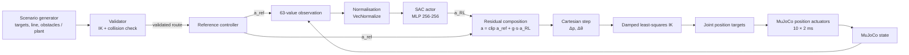

# Curriculum Residual SAC for a UR10e Robot Arm in MuJoCo

**Soft Actor-Critic (SAC) + inverse kinematics + a route-following reference controller, trained through a
curriculum of reaching, path-following and obstacle-avoidance missions, with two optional missions for
pineapple harvesting through flexible leaves.**

 
 

---

## Abstract

This project trains a 6-DoF **Universal Robots UR10e** arm with a parallel gripper in the **MuJoCo** physics simulator
to solve a sequence of increasingly difficult manipulation tasks. The policy is learned with **Soft Actor-Critic**
(Stable-Baselines3) and acts in Cartesian space: every action is a small change of the tool pose, converted to joint
targets by a damped-least-squares **inverse-kinematics** (IK) solver. Instead of learning the whole motion from
scratch, the network learns a bounded **residual correction** on top of a simple **reference controller** that
follows a collision-free route computed when each scenario is generated (*residual reinforcement learning*).

Three core missions are trained one after another, and each mission starts from the weights of the previous one
(**curriculum + transfer learning**): (1) reaching a random target with an adaptive precision curriculum down to
**5 mm**, (2) reaching a start point and then following a straight line, and (3) following the line through a
"constellation" of point obstacles. Two **optional** missions extend the same pipeline to agricultural harvesting:
(4) reaching the grasp pose of a pineapple through randomly generated flexible leaves, and (5) the full harvest
(grip, twist, pull back, lift out).

On 200 unseen test scenarios per mission, the trained policies reach **100 %** success in Missions 1–3. The residual
correction is what makes the 5 mm precision of Mission 1 reliable (reference alone 90 % → with RL 100 %) and
it shortens Mission 2 episodes by 11 %. In the optional harvesting missions the planner and reference
controller do most of the work: success is **84.0 %** for Mission 4 and **60.5 %** for the full harvest in
Mission 5, and the RL correction does not measurably improve on the reference alone there. All numbers, their
confidence intervals and the evaluation protocol are given in [Results](#6-results).

---

## Table of contents

1. [Highlights](#1-highlights)
2. [System overview](#2-system-overview)
3. [The missions](#3-the-missions)
4. [Method and mathematics](#4-method-and-mathematics)
5. [Evaluation protocol](#5-evaluation-protocol)
6. [Results](#6-results)
7. [Parameters and hyperparameters](#7-parameters-and-hyperparameters)
8. [Project structure and the role of each script](#8-project-structure-and-the-role-of-each-script)
9. [Installation and usage](#9-installation-and-usage)
10. [Optional Missions 4–5: including or excluding them](#10-optional-missions-45-including-or-excluding-them)
11. [Deployment notes (sim-to-real)](#11-deployment-notes-sim-to-real)
12. [Limitations](#12-limitations)
13. [Development history](#13-development-history)
14. [Troubleshooting](#14-troubleshooting)
15. [Acknowledgements, license and citation](#15-acknowledgements-license-and-citation)

---

## 1. Highlights

| | |
|---|---|
| **Robot** | UR10e (official kinematics and dynamics) + parallel gripper; Missions 4–5 use an approximation of the DH-Robotics PGIA-140-80 gripper and a wrist camera |
| **Simulator** | MuJoCo 3, 2 ms physics step, 20 ms control step (10 sub-steps) |
| **Algorithm** | SAC (Stable-Baselines3) with a customised training step: frozen-actor critic warm-up, actor anchor, entropy cap |
| **Policy structure** | Residual: `action = reference action + bounded SAC correction` |
| **Action space** | 6-D, normalised to [−1, 1]: tool translation (≤ 5 cm/step) + tool rotation (≤ 0.08 rad/step) → IK → joint targets |
| **Observation** | One fixed **63-value** layout for all five missions, so weights transfer directly between missions |
| **Curriculum** | Adaptive precision threshold (Mission 1), difficulty levels (Missions 3–5), weight transfer between missions |
| **Evaluation** | Separate validation and test seeds, 200 held-out test scenarios, 95 % Wilson confidence intervals, paired comparison against the reference controller alone |
| **Export** | ONNX with the observation normalisation baked in, verified against the PyTorch policy |
| **Result** | Missions 1–3: 100 % on 200 unseen scenarios each (5 mm precision in Mission 1) |

---

## 2. System overview



**Control loop (every 20 ms).**
1. The environment builds the 63-value observation, which includes the reference controller's own action for this state.
2. The SAC actor outputs a correction in [−1, 1]⁶.
3. The correction is scaled, optionally faded out near obstacles or the grasp point, and added to the reference action.
4. The resulting tool-pose change is converted into joint targets by IK, limited to 0.25 rad per step.
5. MuJoCo integrates 10 physics steps of 2 ms with position-controlled actuators (gravity-compensated).
6. Reward and termination are computed; contacts with the robot itself, the floor or obstacles end the episode.

**Why residual RL?** In the earlier version of this project the policy produced the full action ("direct" mode).
It reached 66–86 % on the evaluation tasks, and most failures came from the policy choosing routes that folded the
arm into itself or the floor. The scenario validator already knew a collision-free route, but the policy could not
see it. Following that route with a 20-line controller alone scored 90–100 %. The residual structure gives the policy
that route as a starting point and lets it learn only what the route-follower gets wrong (precision, speed).

---

## 3. The missions

Each mission is trained by its own script, and Mission *N+1* loads the weights of Mission *N*.
Missions 1–3 are the **core** of the project. Missions 4–5 are **optional additions** for users who want the
pineapple-harvesting extension; the core project runs without them (see [Section 10](#10-optional-missions-45-including-or-excluding-them)).

| Mission | Task | What is new | Success criterion | Episode limit |
|---|---|---|---|---|
| **1. Reaching** | Move the tool centre point (TCP) to a random target | Adaptive precision curriculum 10 cm → 5 cm → 2 cm → 1 cm → **5 mm** | TCP within the current threshold (final: 5 mm) | 200 steps (4 s) |
| **2. Path following** | Reach start point T1, then follow the straight line T1 → T2 (0.15–0.50 m) | Phase flag, line features, cross-track penalty | Reach T2 within 2 cm | 300 steps |
| **3. Obstacle avoidance** | As Mission 2, through a constellation of point obstacles | Obstacle features (4 nearest obstacles), potential-based shaping, 5 difficulty levels | Reach T2 within 2 cm without touching any obstacle | 350 steps |
| **4. Reach the fruit** *(optional)* | Reach the grasp pose of a pineapple (crown neck or fruit body) through flexible leaves | Random plant, leaves blocking the top/front/left/right, approach line from the *stargaze* planner, gripper orientation | TCP within 1.5 cm and gripper within 12° of the grasp pose | 300 steps |
| **5. Full harvest** *(optional)* | Mission 4, then grip, twist, pull back and lift the fruit out of the leaves | Scripted grip and twist, detachment model, carried fruit collides with leaves | Fruit detached and carried to the exit point | 450 steps |

### 3.1 Mission 1 — reaching with an adaptive threshold
Targets are drawn in a ring around the robot (radius 0.35–0.48 m, height 0.25–0.45 m above the base, any azimuth).
The success threshold starts at 10 cm and tightens to the next level when the success rate over the last 100
episodes reaches 85 % (minimum 100 episodes per level). Only the success bonus grows with the level
(`10 × 1.2^level`), so the dense reward terms keep the same scale throughout.

### 3.2 Mission 2 — reaching and line following
Phase 0 reaches T1 (within 2 cm), phase 1 follows the segment T1 → T2. The observation adds the phase flag, the line
direction, the vector from the TCP to the closest point on the line and the progress along it.

### 3.3 Mission 3 — obstacle avoidance (stargaze constellation)
T2 is the *nucleus* of a constellation: three nested cubes (half-sizes 0.1/0.2/0.3 m) with 3–5 point obstacles per
face. T1 is chosen on the outer cube so that the line T1 → T2 keeps a clearance from all obstacles (the *stargaze*
max-clearance idea). The validator rolls the reference route out through IK once and removes obstacles that the
robot body would sweep through, so every scenario has a collision-free solution. A 5-level curriculum shrinks the safe
corridor around the route from 12 cm to 1 cm and widens the reachable workspace.

### 3.4 Mission 4 — reaching the fruit through leaves *(optional)*
Every episode draws a new pineapple plant: stalk, fruit (Ø 8–14 cm), crown neck (Ø 3–5.5 cm), 4 crown leaves,
8–14 rosette leaves (10–14 at the final level) and up to 8 **blocking leaves** crossing the top, front, left or right side of the fruit (each
side independently with probability `p_block`, sometimes all four). Leaves are chains of capsules with spring hinges:
they bend when pushed and spring back. The approach line comes from the stargaze planner applied to leaf points; the
gripper must arrive with the fingers straddling the neck (or fruit) and the closing axis horizontal. Touching leaves is
allowed but penalised; bending a leaf hinge beyond 30°, hitting the stalk/fruit, self-collision or floor contact end the episode.

### 3.5 Mission 5 — full harvest *(optional)*
After reaching the grasp pose, a scripted sequence closes the force-limited fingers (with lateral compliance so both
fingers touch), twists the gripper about the fruit axis by a random 45–120°, and decides whether the stalk breaks
from a grip-torque rule. The fruit is then carried back 22 cm along the approach line and lifted 8 cm, colliding with
the leaves on the way. The RL correction acts in the reach and pull-out phases; grip and twist are scripted.

---

## 4. Method and mathematics

### 4.1 Markov decision process

The task is an episodic MDP $(\mathcal{S}, \mathcal{A}, P, r, \gamma)$ with discount $\gamma = 0.995$ and a control
period $\Delta t = 20$ ms.

**Action.** $a \in [-1, 1]^6$, $a = [a_p, a_\theta]$. The commanded tool motion is

$$\Delta p = a_p \cdot \Delta p_{\max}, \qquad \Delta\theta = a_\theta \cdot \Delta\theta_{\max},
\qquad \Delta p_{\max} = 0.05\ \text{m},\ \Delta\theta_{\max} = 0.08\ \text{rad}.$$

The target orientation is integrated in the world frame, $q^{*}_{t+1} = \exp(\Delta\theta) \otimes q^{*}_t$, and kept
inside a cone of 30° around the home orientation (Missions 1–3) to keep IK well-posed. The IK solution is limited to
$|q_{\text{cmd}} - q| \le 0.25$ rad per joint per step.

**Observation (63 values, identical layout in every mission).** Fields that are not used by a mission are held
constant, and are marked inactive so transfer learning can treat them as new inputs when they become active.

| Field | Size | Meaning | Active from |
|---|---|---|---|
| `rel_target` | 3 | active target − TCP position (m) | 1 |
| `q`, `qd` | 6 + 6 | joint angles and velocities | 1 |
| `tcp_pos` | 3 | TCP position relative to the base | 1 |
| `tcp_rot6` | 6 | first two columns of the TCP rotation matrix (continuous 6-D rotation representation) | 1 |
| `manip` | 1 | manipulability $w = \sqrt{\det(J_p J_p^\top)}$ (singularity indicator) | 1 |
| `prev_action` | 6 | previous executed action | 1 |
| `time_left` | 1 | $1 - t/T_{\max}$ | 1 |
| `phase` | 1 | 0 = reaching T1, 1 = following T1→T2 (Mission 5: 2 = pulling back, 3 = lifting) | 2 |
| `path_dir` | 3 | unit vector T1 → T2 | 2 |
| `cross_track_vec` | 3 | vector TCP → closest point on the segment | 2 |
| `path_progress` | 1 | projection of the TCP on the segment, 0…1 | 2 |
| `obs_rel` | 12 | vectors from the closest robot point to the 4 nearest obstacles (Missions 4–5: leaf points; slot 4 = wrist force) | 3 |
| `obs_dist` | 4 | surface distances to those obstacles, clipped to 0…1 m | 3 |
| `min_clearance` | 1 | minimum clearance of the whole robot body | 3 |
| `ref_action` | 6 | the reference controller's action in this state | 1 |

Sensor noise ($\sigma = 0.005$) is added to continuous active fields during training only.

**Observation normalisation.** A running mean and variance (Stable-Baselines3 `VecNormalize`) gives
$\hat{o} = \mathrm{clip}\big((o-\mu)/\sqrt{\sigma^2+\epsilon},\,-10,\,10\big)$. After a transfer the statistics are
frozen, because updating them would shift the inputs of the transferred policy.

### 4.2 Inverse kinematics (damped least squares)

For the target pose $(p^{*}, q^{*})$ the solver iterates from the current joint state:

$$e = \begin{bmatrix} p^{*} - p(q) \\ w_r\,\mathrm{Log}(q^{*} \otimes q(q)^{-1}) \end{bmatrix},\qquad
\Delta q = J_w^\top \left(J_w J_w^\top + \lambda^2 I\right)^{-1} e_w,$$

with rotation weight $w_r = 0.5$, a step limit of 0.3 rad, up to 60 iterations, and tolerances of 0.1 mm and 0.002 rad.
The damping grows near singularities:

$$\lambda = \lambda_{\min} + (\lambda_{\max} - \lambda_{\min})\,\mathrm{clip}\!\left(1 - \frac{w}{w_0}, 0, 1\right),
\qquad \lambda_{\min}=10^{-4},\ \lambda_{\max}=0.05,\ w_0 = 0.02.$$

The result is clamped to the joint limits and unwrapped to the solution closest to the current configuration.

### 4.3 Reference controller and residual policy

The **reference controller** is a saturated proportional controller towards a moving target point:

$$a_{\text{ref},p} = \mathrm{sat}_1\!\left(\frac{k\,(p_{\text{tgt}} - p)}{\Delta p_{\max}}\right),\qquad k = 0.8,\qquad
\mathrm{sat}_1(v) = \begin{cases} v & \|v\|\le 1 \\ v/\|v\| & \text{otherwise}\end{cases}$$

where $p_{\text{tgt}}$ is the validated approach waypoint two steps ahead of the closest one (phase 0, `lookahead = 2`)
or the active target (later phases). In Missions 1–3 it does not rotate the gripper ($a_{\text{ref},\theta}=0$). In
Missions 4–5 it also rotates towards the required orientation, $a_{\text{ref},\theta} =
\mathrm{sat}_1(k_\theta\,\mathrm{Log}(q_{\text{des}} \otimes q^{*-1})/\Delta\theta_{\max})$, and slows translation
while the wrist lags behind.

The **executed action** is

$$a = \mathrm{clip}\big(a_{\text{ref}} + g \cdot s \odot a_{\text{RL}},\ -1,\ 1\big),$$

with residual scale $s = [0.5, 0.5, 0.5, s_\theta, s_\theta, s_\theta]$, so the correction can change the tool position by at most
2.5 cm per step. The gate $g$ is 1 except:

* Mission 3, near obstacles: $g = \mathrm{clip}\big((c_{\min} - 0.02)/(0.08 - 0.02), 0, 1\big)$, and $s_\theta = 0$
  (the validated route assumes the nominal orientation).
* Missions 4–5, near the grasp point: $g = \mathrm{clip}\big((d - 0.04)/(0.10 - 0.04), 0, 1\big)$, plus a
  **progress floor**: the component of $a_p$ along $a_{\text{ref},p}$ is kept at least $0.4\,\|a_{\text{ref},p}\|$,
  so the correction can steer and change speed but cannot stop the arm.

### 4.4 Reward functions

All missions share four dense terms, with $d_t$ the distance from the TCP to the active target:

$$r^{\text{common}}_t = \underbrace{-0.02}_{\text{time}} \;\underbrace{-\,0.5\,d_t}_{\text{distance}}
\;+\;\underbrace{20\,(d_{t-1} - d_t)}_{\text{progress}} \;\underbrace{-\,0.05\,\|a_t - a_{t-1}\|^2}_{\text{smoothness}}.$$

The progress term is symmetric (moving away costs as much as moving closer earns), so it adds no bias to the optimum.

| Mission | Additional terms |
|---|---|
| 1 | success $+10 \cdot 1.2^{\ell}$ (curriculum level $\ell$); self/floor contact $-10$ and terminate |
| 2 | phase change $+5$; cross-track $-150\,\min(d_\perp, 0.08)^2$; success $+20$ |
| 3 | as Mission 2, success $+40$; collision with an obstacle $-100$ and terminate; obstacle shaping (below) |
| 4 | cross-track; orientation $-0.5\,\theta_{\text{err}}$; leaf energy $-0.15\,\min(E_{\text{leaf}}/0.1\,\text{J},\,3)$; timeout $-20$; plant/leaf damage $-50$; success $+40$ |
| 5 | as Mission 4, plus grip $+10$, detachment $+10$, harvest failure $-30$, success at the exit point $+40$ |

**Potential-based obstacle shaping (Mission 3).** With $c$ the minimum robot–obstacle clearance,

$$\Phi(c) = \begin{cases} -k\left(\dfrac{1}{c+\varepsilon} - \dfrac{1}{d_{\text{safe}}+\varepsilon}\right) & c < d_{\text{safe}} \\ 0 & \text{otherwise}\end{cases},
\qquad F_t = \gamma\,\Phi(c_{t+1}) - \Phi(c_t),$$

with $k = 0.3$, $\varepsilon = 0.01$ m, $d_{\text{safe}} = 0.12$ m. Potential-based shaping leaves the optimal policy
unchanged (Ng et al., 1999) and, unlike a per-step penalty, does not make standing still near an obstacle cheaper than moving.

**Leaf energy (Missions 4–5).** With $\theta_j$ the deflection of leaf hinge $j$ from its rest shape and $k_j$ its stiffness,
$E_{\text{leaf}} = \tfrac{1}{2}\sum_j k_j\,\theta_j^2$. A leaf counts as damaged when any non-crown hinge exceeds 0.52 rad (≈ 30°).

### 4.5 Soft Actor-Critic and the modifications used here

SAC maximises the entropy-regularised return $\mathbb{E}\big[\sum_t \gamma^t (r_t + \alpha\,\mathcal{H}(\pi(\cdot|s_t)))\big]$.
The actor is a tanh-squashed Gaussian, $a = \tanh(\mu_\phi(s) + \sigma_\phi(s)\,\xi)$, $\xi \sim \mathcal{N}(0, I)$.
Two critics $Q_{\psi_1}, Q_{\psi_2}$ with slowly updated target copies $\bar\psi_i$ are trained on replayed transitions:

$$y = r + \gamma(1-d)\Big(\min_{i} Q_{\bar\psi_i}(s', a') - \alpha \log \pi_\phi(a'|s')\Big),\quad a' \sim \pi_\phi(\cdot|s'),
\qquad J_Q(\psi_i) = \tfrac{1}{2}\,\mathbb{E}\big[(Q_{\psi_i}(s,a) - y)^2\big],$$

$$\bar\psi_i \leftarrow \tau\,\psi_i + (1-\tau)\,\bar\psi_i,\qquad \tau = 0.005.$$

The actor loss used in this project (`shared/training/trainer.py`, class `ArmSAC`) adds two terms to the standard one:

$$J_\pi(\phi) = \mathbb{E}\Big[\alpha \log \pi_\phi(\tilde a|s) - \min_i Q_{\psi_i}(s, \tilde a)\Big]
\;+\; \lambda_\mu\,\mathbb{E}\big[\mu_\phi(s)^2\big]
\;+\; w_t\,\overline{|Q|}\;\mathbb{E}\big[(\tanh\mu_\phi(s) - a_{\text{prior}}(s))^2\big].$$

* **Mean regulariser** $\lambda_\mu = 10^{-3}$, as in the original SAC implementation: keeps the pre-tanh mean out of
  the saturated region, where gradients vanish.
* **Actor anchor** (TD3+BC-style, scaled by the mean absolute Q): pulls the actor towards $a_{\text{prior}}$, which is
  either the policy inherited from the previous mission (`prior`) or the zero correction (`zero`, i.e. "do what the
  reference does"). Its weight decays linearly from 0.4 to a floor (0.1–0.2) over 100–150k steps. Without the floor, the
  critic's over-estimation was exploited as soon as the anchor vanished (measured: Q rose from 26 to 71 while success fell from 90 % to 10 %).

The temperature $\alpha$ is either fixed (Missions 3–5: 0.005) or tuned automatically with
$J(\alpha) = \mathbb{E}[-\alpha(\log\pi(a|s) + \bar{\mathcal{H}})]$ towards a target entropy $\bar{\mathcal{H}}$ (Missions 1–2:
$\bar{\mathcal{H}}=-8$), capped at $\alpha_{\max}$.

**Critic warm-up after a transfer.** For the first 20–25k steps the actor **and** $\alpha$ are frozen and only the
critics learn, so the transferred behaviour is not destroyed by gradients from an untrained critic. Freezing $\alpha$ as
well was the fix for a collapse of Mission 3 to 0 % success (the automatically tuned $\alpha$ grew from 0.033 to 6.8
while the actor was frozen, see [Section 13](#13-development-history)).

**Update-to-data ratio.** One gradient step per environment step across 4 parallel environments (UTD = 0.25) was
both more stable and about 3× faster than UTD = 1.

### 4.6 Curriculum and transfer learning

* **Adaptive threshold (Mission 1).** Level $\ell$ uses threshold $\delta_\ell \in \{10, 5, 2, 1, 0.5\}$ cm; advance when
  the success rate over a 100-episode window reaches 85 % (checked every 50 episodes, after at least 100 episodes at the level).
* **Difficulty levels (Missions 3–5).** Same rule with an 80 % threshold (55 % in Mission 5, where part of the failures
  come from scripted steps RL cannot change). Mission 3 levels shrink the obstacle-free corridor; Missions 4–5 levels
  add blocking leaves, more rosette leaves and stiffer leaves.
* **Single task definition.** Evaluation always uses the *last* curriculum level / threshold from the training config
  (`shared/evaluation/task_spec.py`), so training and evaluation numbers measure the same task.
* **Weight transfer.** All missions share the network shape and the 63-value observation, so Mission *N*'s weights load
  directly. For inputs that become active in the new mission (or change meaning), the first-layer weights of the actor
  and both critics are set to zero, so the transferred policy initially ignores them, and their normalisation statistics
  are estimated from 8000 real observations of the new mission.

### 4.7 Scenario generation and validation

Every reset draws a scenario and checks it with the same IK the environment uses, rejecting or repairing it if:
the target is unreachable; the straight (or, if blocked, polar) approach route self-collides or touches the floor;
the route passes near a wrist singularity (Missions 4–5); or the robot body sweeps through obstacles / hard plant parts.
The validated route is what the reference controller follows.

**Stargaze max-clearance line (Missions 3–5).** For candidate start points $S$ on the allowed cube faces around the
nucleus $N$ (all faces except the back and the bottom), with obstacle/leaf points $p_i$ of radius $r_i$:

$$C(S) = \min_i \Big(\mathrm{dist}\big(p_i, \overline{SN}\big) - r_i\Big), \qquad S^{*} = \arg\max_S C(S).$$

In Missions 4–5 the grip mode follows the line elevation (crown from above or almost horizontally, fruit body from the
side) and is only used if the part fits between the fingers: finger gap $\in [2o,\ 2o + 80\ \text{mm}]$ for finger offset $o$.

---

## 5. Evaluation protocol

* **Seeds.** Checkpoint selection during training uses a fixed set of 50 evaluation scenarios. At the end, the `best`
  and `final` models are compared on **100 validation scenarios** (seeds 300000+), and the winner is tested on
  **200 test scenarios** (seeds 400000+) that were never used for any decision → `checkpoints/missionN/final_test.json`.
  The comparisons in this README use a further independent set (seeds 600000+).
* **Confidence interval.** 95 % Wilson score interval for a success proportion $\hat p = k/n$:
  $$\frac{\hat p + \frac{z^2}{2n} \pm z\sqrt{\frac{\hat p(1-\hat p)}{n} + \frac{z^2}{4n^2}}}{1 + \frac{z^2}{n}},\qquad z = 1.96.$$
  With 200 scenarios, a 90 % result has an interval of about ±4 points; 10 scenarios would give ±20.
* **Paired comparison.** "Reference alone" (zero RL action) and "reference + RL" run on the *same* scenarios. The
  difference is judged by the scenarios where exactly one of them succeeds, with a two-sided exact sign (binomial) test.
* **Conditions.** *Final task* = last curriculum level; *DR + noise* = domain randomisation (payload +0–1 kg, gravity
  ×0.98–1.02) and observation noise σ = 0.005; Missions 4–5 additionally *perfect plan* (the planner knows every leaf).
* **ONNX check.** Every exported model is compared with the PyTorch actor on real observations (tolerance 1e-4).

---

## 6. Results

All numbers below were measured on the models shipped in `models/` and `checkpoints/`, with the evaluation scripts
in `checkpoints/final_eval_user/` (raw data in the JSON files next to them).

### 6.1 Held-out test of the training pipeline

| Mission | Training steps | Selected model | Test success (200 unseen scenarios) | 95 % CI |
|---|---|---|---|---|
| 1 | 1,000,000 | best | **100.0 %** (200/200) | 98–100 % |
| 2 | 1,000,000 | best | **100.0 %** (200/200) | 98–100 % |
| 3 | 1,000,000 | best | **100.0 %** (200/200) | 98–100 % |
| 4 *(optional)* | 1,000,000 | best | **82.5 %** (165/200) | 77–87 % |
| 5 *(optional)* | 675,000 (stopped early) | best | **54.0 %** (108/200) | 47–61 % |

### 6.2 Contribution of the RL correction (same 200 scenarios, seeds 600000+)

| Mission | Condition | Reference alone | Reference + RL | Mean steps to success (ref → RL) | Failures (ref / RL) |
|---|---|---|---|---|---|
| 1 (final threshold 5 mm) | final task | 90.0 % (85–93 %) | **100.0 %** (98–100 %) | 104.5 → 100.6 | timeout 20 / — |
| 1 (final threshold 5 mm) | DR + noise | 94.5 % (90–97 %) | **100.0 %** (98–100 %) | 108.2 → 99.9 | timeout 11 / — |
| 2 (2 cm) | final task | 100.0 % (98–100 %) | **100.0 %** (98–100 %) | 143.6 → 128.3 | — / — |
| 2 (2 cm) | DR + noise | 100.0 % (98–100 %) | **100.0 %** (98–100 %) | 139.1 → 125.2 | — / — |
| 3 (final level, 1 cm corridor) | final task | 99.5 % (97–100 %) | **100.0 %** (98–100 %) | 147.8 → 141.2 | collision 1 / — |
| 3 (final level, 1 cm corridor) | DR + noise | 99.0 % (96–100 %) | **99.0 %** (96–100 %) | 143.5 → 136.4 | collision 2 / collision 1, timeout 1 |

* **Mission 1:** the reference controller alone times out short of the 5 mm target in 20 of 200 scenarios; with the correction all 200 succeed. Here the RL correction is what delivers the precision.
* **Mission 2:** both reach 100 %; the correction makes the motion 11 % shorter (144 → 128 steps, 20 ms each).
* **Mission 3:** the validated route already avoids the obstacles (reference alone 99.5 %); the correction removes the remaining collision and is 4 % faster. Under domain randomisation both reach 99.0 %.
* Interpretation: in Missions 1–3 the controller is a **planner + reference controller with a learned residual**; most of the safety comes from the validated route, and the learned part adds precision and speed.

### 6.3 Curriculum progress

| Mission | Level reached (training steps) |
|---|---|
| 1 | 10 cm → 5 cm at 8.7k, → 2 cm at 18.3k, → 1 cm at 29.0k, → 5 mm at 40.0k steps |
| 3 | level 1 at 12.5k, 2 at 25.9k, 3 at 39.0k, 4 (final, 1 cm corridor) at 52.3k steps |
| 4 *(optional)* | level 1 at 10.0k, 2 at 20.1k, 3 (final) at 30.7k steps |
| 5 *(optional)* | level 1 at 15.1k, 2 (final) at 46.1k steps |

All curricula reached their final level within the first ~50k steps, because the reference controller already solves
most scenarios; the remaining steps refine the correction. Training curves (TensorBoard exports) are in
`checkpoints/missionN/debug/training_curves.png`.

### 6.4 Optional Missions 4–5

| Mission | Condition | Reference alone | Reference + RL | Paired: RL-only / ref-only successes (p) |
|---|---|---|---|---|
| 4 | final task (with planning error) | 83.0 % (77–88 %) | 84.0 % (78–88 %) | 5 / 3 (p = 0.73) |
| 4 | perfect plan (all leaves known) | 92.5 % (88–95 %) | 92.5 % (88–95 %) | 4 / 4 (p = 1.00) |
| 4 | DR + noise (with planning error) | 85.0 % (79–89 %) | 83.0 % (77–88 %) | 3 / 7 (p = 0.34) |
| 5 | final task (with planning error) | 61.0 % (54–67 %) | 60.5 % (54–67 %) | 13 / 14 (p = 1.00) |
| 5 | perfect plan (all leaves known) | 70.0 % (63–76 %) | 69.5 % (63–75 %) | 11 / 12 (p = 1.00) |
| 5 | DR + noise (with planning error) | 58.5 % (52–65 %) | 56.5 % (50–63 %) | 23 / 27 (p = 0.67) |

* **Mission 4** failures, final task (reference / RL): leaf_overbend 16, timeout 13, plant_hit 3, fruit_hit 2 / leaf_overbend 13, timeout 13, plant_hit 3, fruit_hit 3. No significant difference in any condition.
* **Mission 5** failures, final task (reference / RL): leaf_overbend 26, grasp_miss 15, twist_fail 14, timeout 13, grip_slip 5, plant_hit 3, fruit_hit 2 / grasp_miss 22, leaf_overbend 20, timeout 12, twist_fail 10, grip_slip 5, plant_hit 4, fruit_hit 4, self_collision 2. 77 of the reference controller's 78 failures happen **before** the fruit is detached (reaching, gripping, twisting); pulling the fruit out of the leaves almost always works.
* Success of the reference controller by approach side (Mission 5, scenes): top 71 % (91), front 50 % (64), left 58 % (24), right 52 % (21). Approaches from the top grip the crown and twist with the wrist alone; side grips must swing the wrist around the crown and fail the twist more often.
* A perfect leaf map raises the reference controller by 9.5 points (Mission 4) and 9.0 points (Mission 5).
* The Mission 5 model in `checkpoints/mission5/` was stopped at 675k of the planned 1 M steps; its training test is also listed in Section 6.1.
* Recommendation for the optional missions: deploy the planner + reference controller; treat the RL correction as an experiment until it beats the reference on real data.

### 6.5 Discussion

* **Where RL helps.** Precision and speed: Mission 1 at 5 mm is the clearest case. The reference controller is a
  proportional controller with a fixed gain and stalls short of a 5 mm target in some configurations; the learned
  correction removes those timeouts. In Mission 2 the correction shortens the motion.
* **Where it does not.** In Missions 3–5 the validated route (and in 4–5 the stargaze plan) already contains the hard
  part of the problem: where to go so that nothing is hit. The remaining failures in Missions 4–5 are mostly physical
  (a leaf that must be bent, a twist the wrist cannot reach, a grip that slips) and the correction does not remove them.
* **What matters most for harvesting.** A perfect leaf map raises the reference controller's success by about 9–10
  points in both optional missions, more than the RL correction. Better leaf perception is the most valuable next step.

---

## 7. Parameters and hyperparameters

Every parameter lives in YAML; there are no command-line arguments. Each mission has three files:
`sac_config.yaml` (training), `domain_randomization.yaml` (environment) and `eval_config.yaml` (evaluation).

### 7.1 SAC (`MissionN/configs/sac_config.yaml` → `sac:`)

| Parameter | Value | Role |
|---|---|---|
| `learning_rate` | 3e-4 (M1), 1e-4 (M2), 1.5e-4 (M3–5) | Adam step size for actor, critics and α. Smaller when fine-tuning a transferred policy, so it is not overwritten quickly |
| `buffer_size` | 250 000 per env (1 M total) | Replay memory: how many past transitions the critics can learn from |
| `learning_starts` | 5 000 | Steps collected before the first gradient update. With residual/transfer, these are collected with the current policy, not random actions |
| `batch_size` | 256 | Transitions per gradient step: larger = less noisy gradients |
| `gamma` | 0.995 | Discount factor: effective horizon ≈ 1/(1−γ) = 200 steps (4 s), about one episode |
| `tau` | 0.005 | Polyak rate of the target critics: smaller = more stable but slower-moving targets |
| `train_freq`, `gradient_steps` | 1, 1 | One gradient step after each vector step of 4 envs (update-to-data 0.25) |
| `ent_coef` | `auto_0.01` (M1–2), `0.005` fixed (M3–5) | Entropy temperature α: exploration vs exploitation. `auto_x` tunes it starting at x |
| `target_entropy` | −8 (M1–2) | Desired policy entropy for automatic α; lower = more deterministic corrections |
| `ent_coef_max` | 0.05 (M1), 0.02 (M2–5) | Upper bound on automatic α (protection against α runaway) |
| `actor_mean_reg` | 1e-3 | $\lambda_\mu$: keeps the pre-tanh mean away from saturation |
| `residual_log_std_init` | −1.6 | Initial exploration noise of the correction (σ ≈ 0.2 before tanh ≈ 5 mm per step) |
| `residual_critic_warmup_steps` | 20 000 (M1) | Critic-only training at the start of Mission 1 |
| `residual_anchor_coef / _steps / _floor` | 0.4 / 100k / 0.1 (M1) | Weight, decay length and minimum of the zero-correction anchor |
| `net_arch`, `qf_net_arch` | [256, 256] | Hidden layers of actor and critics; must be identical in all missions for weight transfer |
| `activation_fn` | ReLU | Hidden activation |

### 7.2 Run, evaluation and export (`run:`, `normalization:`, `export:`)

| Parameter | Value | Role |
|---|---|---|
| `timesteps` | 1 000 000 | Total environment steps of training |
| `n_envs`, `vec_env` | 4, `auto` | Parallel environments (subprocesses when > 1) |
| `seed` | 4–8 per mission | Random seed (environments use seed + 1000·i) |
| `eval_freq`, `eval_episodes`, `eval_seed` | 25 000, 50, 424242 | Periodic deterministic evaluation on fixed scenarios → `best_model.zip` |
| `ckpt_freq` | 500 000 (100 000 in M5) | Periodic checkpoints (model + normalisation; the replay buffer is not saved) |
| `final_validation_episodes`, `final_test_episodes` | 100, 200 | End-of-training model selection and held-out test |
| `clip_obs`, `epsilon`, `norm_reward` | 10, 1e-8, false | Observation normalisation clip and numerical epsilon; rewards are not normalised |
| `export.source` | `auto` | Which model becomes ONNX: the better of best/final on the validation set |
| `verify_tolerance` | 1e-4 | Maximum allowed ONNX vs PyTorch difference |

### 7.3 Transfer (`transfer:`, Missions 2–5)

| Parameter | Value | Role |
|---|---|---|
| `source_model`, `source_vecnormalize` | previous mission's `best_*` | Weights and normalisation to start from |
| `zero_new_input_weights` | true | Zero the first-layer weights of newly active inputs (actor + both critics) |
| `freeze_obs_rms` | true | Keep the normalisation statistics fixed during training |
| `warm_stats_steps`, `obs_rms_count` | 8000, 50 000 | Observations used to estimate statistics of new inputs; pseudo-count so they do not jump |
| `critic_warmup_steps` | 25 000 | Actor and α frozen, critics only |
| `reset_residual_output` | true (M3, M4) | Restart the correction from zero (behaviour = reference controller) instead of inheriting it |
| `actor_anchor_target` | `prior` (M2, M5) / `zero` (M3, M4) | Anchor towards the previous policy or towards no correction |
| `actor_anchor_coef / _steps / _floor` | 0.4 / 150k / 0.15–0.2 | Anchor schedule after warm-up |
| `reinit_constant_dims` | true (M4–5) | Treat inputs that were constant in the source mission as new |
| `reinit_fields` | `obs_rel[9:12]`, `obs_dist[3]` (M4–5) | Inputs whose meaning changes (4th obstacle slot → wrist force) |
| `refit_all_stats` | true (M4) | Re-estimate the statistics of all inputs (plants instead of point obstacles) |

### 7.4 Environment (`domain_randomization.yaml`)

| Parameter | Value | Role |
|---|---|---|
| `action.max_pos_delta` | 0.05 m | Tool translation per step at action 1 |
| `action.max_rot_delta` | 0.08 rad | Tool rotation per step at action 1 |
| `action.max_joint_delta` | 0.25 rad | Joint target change limit per step (prevents IK jumps) |
| `action.max_orientation_dev_deg` | 30° (M1–3), 180° (M4–5) | Orientation cone around home; opened for harvesting where the gripper must turn |
| `action.max_orient_lead_deg` | 8° (M4–5) | Target orientation may lead the actual one by at most this (the wrist moves ~0.05 rad/step) |
| `physics.n_substeps` | 10 | Physics steps per control step (2 ms × 10 = 20 ms) |
| `physics.gravity_compensation` | true | Nominal gravity compensation: the arm holds its pose at zero action |
| `ik.*` | 60 iters, 0.1 mm, 0.002 rad, rot weight 0.5 | IK solver settings (Section 4.2) |
| `robot_dynamics.payload_mass_range` | 0–1 kg (M1–3), 0–0.3 kg (M4–5) | Random extra mass at the gripper (domain randomisation) |
| `robot_dynamics.gravity_scale_range` | 0.98–1.02 | Random gravity scale, partially uncompensated |
| `randomization.init_joint_noise` | 0.05 rad | Random initial pose around home (training only) |
| `randomization.obs_noise_std` | 0.005 | Sensor noise on continuous observations (training only) |
| `episode.max_steps` | 200 / 300 / 350 / 300 / 450 | Time limit per mission |
| `episode.success_pos_threshold` | 0.10→0.005 (M1), 0.02 (M2–3), 0.015 (M4) | Success distance |
| `path_task.t1_reach_threshold` | 0.02 m (0.03 in M4–5) | Distance to T1 that switches to the line phase |
| `path_task.cross_track_cap` | 0.08 m | Cross-track error is capped inside the penalty so the value loss cannot explode |
| `safety.terminate_on_contact` | true | End the episode on self-collision or floor contact |
| `validation.*` | 40 attempts, 2 mm IK tolerance, 4 cm waypoints | Scenario validation settings |
| `policy_structure.type` | `residual` | `residual` (default) or `direct` (the policy outputs the full action) |
| `residual_scale_pos`, `residual_scale_rot` | 0.5; 1.0 (M1–2), 0.0 (M3), 0.5 (M4–5) | Maximum size of the correction relative to a full action |
| `reference.gain`, `reference.lookahead` | 0.8, 2 | Reference controller gain and waypoint lookahead |
| `residual_obstacle_gate` | [0.02, 0.08] m (M3) | Clearance band over which the correction fades out near obstacles |
| `target_gate`, `progress_min` | [0.04, 0.10] m, 0.4 (M4–5) | Correction fade-out near the grasp point; minimum forward progress |
| `safety_filter.enabled` | false | Optional one-step look-ahead collision filter (`shared/safety/shield.py`) |

### 7.5 Reward weights (`reward:`)

| Parameter | Value | Role |
|---|---|---|
| `time_penalty` | −0.02 | Encourages finishing quickly |
| `distance_penalty` | 0.5 | Dense pull towards the target |
| `progress_weight` | 20 | Reward per metre of progress (symmetric shaping) |
| `smoothness_penalty` | 0.05 | Penalises jerky changes of action |
| `contact_penalty` | −10 | Self-collision / floor contact |
| `success_reward` | 10 (×1.2^level, M1), 20 (M2), 40 (M3–5) | Terminal bonus |
| `cross_track_penalty` | 150 | Weight of the squared distance to the line |
| `phase_transition_bonus` | 5 | Bonus for reaching T1 |
| `collision_penalty` | −100 (M3) | Obstacle collision |
| `obstacle_potential_k`, `obstacle_eps`, `d_safe`, `obstacle_gamma` | 0.3, 0.01, 0.12 m, 0.995 | Potential-based obstacle shaping (Section 4.4) |
| `orientation_penalty` | 0.5 per rad (M4–5) | Gripper orientation error in the line phase |
| `leaf_energy_penalty`, `leaf_energy_cap` | 0.15, 3 (M4–5) | Penalty on the elastic energy of bent leaves |
| `timeout_penalty` | −20 (M4–5) | Makes "stopping in front of leaves" no cheaper than trying |
| `plant_hit_penalty`, `leaf_overforce_penalty` | −50 (M4–5) | Damage to the plant |
| `grasp_bonus`, `detach_bonus`, `harvest_fail_penalty` | +10, +10, −30 (M5) | Harvest sequence outcome |

### 7.6 Curriculum (`adaptive:` / `curriculum:`)

| Parameter | Value | Role |
|---|---|---|
| `adaptive.thresholds` | [0.10, 0.05, 0.02, 0.01, 0.005] m | Mission 1 precision levels; the last one is the evaluated task |
| `success_rate_to_advance` / `advance_success_rate` | 0.85 (M1), 0.80 (M3–4), 0.55 (M5) | Success rate needed to advance a level |
| `check_every_n_episodes`, `window_episodes`, `warmup_episodes` | 50, 100, 100 | How often, over how many episodes, and after how many episodes at a level the rule is checked |
| `reward_success_multiplier` | 1.2 | Growth of the success bonus per Mission 1 level |
| Mission 3 `levels` | corridor 0.12 → 0.01 m; approach corridor 0.20 → 0.15 m; reach limits widen | Difficulty schedule |
| Missions 4–5 `levels` | `p_block` 0 → 0.6, `p_all_sides` 0 → 0.25, rosette 6–10 → 10–14, stiffness ≤ 4 → ≤ 10 N·m/rad | Plant difficulty schedule |

### 7.7 Missions 4–5 specific (`domain_randomization.yaml`)

| Block | Key values | Role |
|---|---|---|
| `plant` | fruit Ø 8–14 cm, height 14–24 cm, centre 0.30–0.60 m; leaves 45–90 cm, stiffness 1–10 N·m/rad | Random plant geometry (**guesses** — replace with field measurements) |
| `block` | `p_block`, `max_per_side`, `p_all_sides`, distance 3–15 cm | Blocking leaves on the top/front/left/right |
| `gripper` | `finger_offset` 0.015 m, stroke 0.04 m/finger, 140 N, 80 % grip force | Finger gap 30–110 mm: crown neck always fits, fruit body only if Ø ≤ ~86 mm |
| `planner` | cube 0.30 m, 21×21 points/face, faces top/front/left/right, elevation limits per grip mode | Stargaze approach line |
| `perception` | 30 % leaves missed, 2 cm noise | Simulated planning error of a camera (0/0 = perfect plan) |
| `observation` | wrist force in the 4th obstacle slot, scale 20 N | UR10e built-in force/torque sensor as an input |
| `contact` | leaf bend 0.52 rad, hard contact 3 N, fingers on target 25 N | Damage and failure limits |
| `harvest_action` (M5) | close 0.7 s, twist 45–120°, μ 0.4–0.8, break torque 0.5–2.5 N·m, pull 20–80 N, retreat 0.22 m, lift 0.08 m | Scripted harvest and detachment model (**guesses**) |

---

## 8. Project structure and the role of each script

```
sac_curriculum_arm/
├── Mission1/ … Mission3/        core missions
│   ├── envs/                    training environment (gymnasium.Env)
│   ├── eval_envs/               evaluation environment (subclass of the training env, visual robot model)
│   ├── configs/                 sac_config.yaml · domain_randomization.yaml · eval_config.yaml
│   ├── debug/                   mission-specific plots (threshold sweep, cross-track, obstacle clearance)
│   ├── train_missionN.py        entry point: training → selection → test → ONNX → debug plots
│   ├── eval_missionN.py         entry point: evaluation in the MuJoCo viewer (or headless)
│   └── benchmark_hybrid_missionN.py   (M2, M3) reference/RL benchmark at 2 cm and 5 mm
├── Mission4/, Mission5/         OPTIONAL harvesting missions (same layout; see Section 10)
│   └── debug/                   harvest_report.py (reference vs RL), render_harvest.py (videos, M5)
├── shared/                      code used by several missions
│   ├── envs/                    base environment, observation layout, robot capsules, validation, path task
│   ├── control/                 reference controller, LQR path controller, hybrid policy, benchmark
│   ├── training/                trainer (ArmSAC), callbacks, transfer learning
│   ├── evaluation/              task definition, viewer evaluation
│   ├── exporter/                ONNX export and verification
│   ├── debug_common/            sanity checks, rollouts, plots, TensorBoard reader
│   ├── safety/                  optional safety filter
│   └── harvest/                 (optional, M4–5) plant, planner, route checker, reference, report
├── ik/                          damped-least-squares IK + pose utilities
├── obstacles/                   stargaze constellation generator (+ interactive visualiser)
├── robot_model/                 MJCF models (train / eval / harvest) + meshes; build_harvest_model.py
├── checkpoints/                 training outputs per mission (models, logs, plots, final_test.json)
├── models/                      exported ONNX policies (+ JSON metadata)
└── requirements.txt
```

### 8.1 Entry points

| Script | Role |
|---|---|
| `MissionN/train_missionN.py` | Runs the whole pipeline for mission N: sanity check (IK, environment, reference controller) → SAC training with TensorBoard → best-vs-final selection on validation scenarios → 200-scenario held-out test → ONNX export + verification → debug plots. No command-line arguments |
| `MissionN/eval_missionN.py` | Evaluates the latest ONNX policy in the MuJoCo viewer (or headless) on the final training task, prints success with a 95 % CI and writes a CSV log and replay plots |
| `Mission2/benchmark_hybrid_mission2.py`, `Mission3/benchmark_hybrid_mission3.py` | Compares "reference alone" vs "reference + RL" (or, for direct policies, RL vs RL + LQR) on fixed scenarios at 2 cm and 5 mm |
| `Mission4/debug/harvest_report.py`, `Mission5/debug/harvest_report.py` | Reference alone vs reference + RL on 100 scenarios, with breakdowns by blocked sides and grip mode |
| `Mission5/debug/render_harvest.py` | Renders harvest videos (outside view + wrist-camera view) offscreen to `checkpoints/mission5/videos/` |
| `robot_model/build_harvest_model.py` | Regenerates `ur10e_harvest.xml` / `scene_harvest.xml` if the gripper or leaf pool sizes change |
| `obstacles/stargaze_visualizer.py` | Interactive 3D tool to explore the stargaze max-clearance line |

### 8.2 Shared modules

| Module | Role |
|---|---|
| `shared/envs/base_arm_env.py` | Base environment for all missions: loads MuJoCo, IK and robot capsules; action → IK → actuators; residual composition; domain randomisation; scenario validation loop; observation; shared reward terms |
| `shared/envs/obs_layout.py` | The 63-value observation layout, active inputs per mission, noise mask |
| `shared/envs/path_task.py` | Phase logic and rewards of Missions 2–3 (reach T1, then follow T1 → T2) |
| `shared/envs/robot_geometry.py` | Robot body as capsules; vectorised robot–obstacle clearance |
| `shared/envs/validation.py` | Reachability checker: IK rollout of straight/polar routes, contact and clearance checks |
| `MissionN/envs/stageN_*_env.py` | Mission-specific scenario sampling, validation and reward (Mission 3: constellation, pruning, potential shaping) |
| `shared/control/reference.py` | Reference controller (route follower) of the residual structure |
| `shared/control/path_controller.py`, `orientation_controller.py`, `hybrid.py`, `controller.yaml` | LQR position controller from an identified plant model, gripper alignment, and an RL + LQR hybrid for policies trained in `direct` mode |
| `shared/control/benchmark.py` | Benchmark engine used by `benchmark_hybrid_missionN.py` |
| `shared/training/trainer.py` | `ArmSAC` (modified SAC training step) and `train_mission()` (the whole training pipeline) |
| `shared/training/callbacks.py` | Adaptive-threshold and difficulty curricula, best-model evaluation, critic warm-up, progress and failure-reason logging |
| `shared/training/transfer.py` | Loads the previous mission's weights and normalisation; zeroes new inputs; re-estimates statistics |
| `shared/evaluation/task_spec.py` | Single definition of each mission's final task, used by training tests, evaluation and benchmarks |
| `shared/evaluation/viewer_eval.py` | Viewer evaluation with markers, CSV log, Wilson CI |
| `shared/exporter/to_onnx.py`, `verify_onnx.py` | Exports the deterministic actor $\tanh(\mu(\hat o))$ with normalisation inside the graph; verifies it |
| `shared/debug_common/*` | Sanity checks, guaranteed-terminating rollouts, training curves, 3D replays, robustness study |
| `shared/safety/shield.py` | Optional safety filter: one-step look-ahead of each action on a copy of the model, replaced by the nearest safe candidate |
| `shared/harvest/plant.py` | (M4–5) Random pineapple plant written into MuJoCo each episode; leaf points, bending, energy |
| `shared/harvest/planner.py` | (M4–5) Stargaze planner on leaves, gripper fit, grasp orientation |
| `shared/harvest/checker.py` | (M4–5) Route validation with changing orientation, wrist-singularity and hard-plant checks |
| `shared/harvest/reference.py` | (M4–5) Reference controller with orientation |
| `shared/harvest/report.py` | (M4–5) Paired reference vs RL evaluation with breakdowns |

### 8.3 Outputs of a training run (`checkpoints/missionN/`)

| File | Content |
|---|---|
| `best_model.zip`, `best_vecnormalize.pkl` | Model with the best periodic evaluation + its normalisation statistics (used by the next mission) |
| `final_model.zip`, `final_vecnormalize.pkl` | Model at the end of training |
| `final_test.json` | Validation (best vs final) and 200-scenario held-out test with CI and failure reasons |
| `best_model_info.json`, `curriculum_state.json`, `eval_log.csv` | Best evaluation details, curriculum history, evaluation log |
| `tb_logs/` | TensorBoard logs (`train/q_pi_mean`, `train/ent_coef`, `curriculum/level`, failure rates, …) |
| `debug/` | Training curves, ONNX vs checkpoint, robustness under domain randomisation, replays, mission plots |
| `models/onnx_missionN_vK.onnx` (+ `.json`) | Exported policy, version K increases on every export |

---

## 9. Installation and usage

### 9.1 Installation

```bash
python -m venv .venv && source .venv/bin/activate      # Windows: .venv\Scripts\activate
pip install -r requirements.txt                          # mujoco, gymnasium, stable-baselines3, torch, onnx, onnxruntime, …
pip install imageio                                      # only for Mission 5 videos
```

Python 3.10+ is recommended. A GPU is not needed: the networks are small and the CPU is usually faster.
On macOS the viewer must be started with `mjpython` instead of `python`.

### 9.2 Training (run in order)

```bash
python Mission1/train_mission1.py
python Mission2/train_mission2.py        # needs checkpoints/mission1/best_model.zip
python Mission3/train_mission3.py        # needs checkpoints/mission2/best_model.zip
# optional:
python Mission4/train_mission4.py        # needs checkpoints/mission3/best_model.zip
python Mission5/train_mission5.py        # needs checkpoints/mission4/best_model.zip
tensorboard --logdir checkpoints
```

Each run overwrites `checkpoints/missionN/` (back it up first). **Ctrl+C is safe**: the best model is still saved,
tested and exported. There is no resume; a restart begins from scratch. On a 2-core CPU, training runs at roughly
55–80 steps per second with 4 environments (≈ 4–5 h for 1 M steps). In development, 120k–300k steps already gave
results close to the final ones, so `timesteps` can be reduced if time is short.

### 9.3 Evaluation and reports

```bash
python Mission3/eval_mission3.py                    # viewer; settings in Mission3/configs/eval_config.yaml
python Mission3/benchmark_hybrid_mission3.py        # reference alone vs reference + RL
python Mission4/debug/harvest_report.py             # optional missions: paired report
python Mission5/debug/render_harvest.py             # optional: videos (offscreen, needs EGL/OSMesa on Linux servers)
python checkpoints/final_eval_user/m123_eval.py     # the 200-scenario comparison of Section 6.2
python checkpoints/final_eval_user/run_final_eval.py 4   # (or 5) the comparison of Section 6.4
```

For numbers that can be compared between models, set `viewer.enabled: false` and `rollout.n_scenarios: 100` or more
in `eval_config.yaml`.

### 9.4 Google Colab

The project runs on Colab's CPU runtime (`pip install -r requirements.txt`, then the training scripts). The viewer does
not work there; use headless evaluation. Copy `checkpoints/` to Google Drive after each mission, because a Colab
session can disconnect and erase local files.

---

## 10. Optional Missions 4–5: including or excluding them

Missions 4 and 5 are an **optional extension** for users interested in agricultural manipulation. They reuse the core
framework (observation layout, residual structure, trainer, transfer, evaluation) and add their own files only:

| To **include** them | To **exclude** them |
|---|---|
| Keep `Mission4/`, `Mission5/`, `shared/harvest/`, `robot_model/build_harvest_model.py`, `robot_model/ur10e_harvest.xml`, `robot_model/scene_harvest.xml` | Delete those folders/files; Missions 1–3 run unchanged |
| Train Missions 1–3 first; Mission 4 starts from `checkpoints/mission3/best_model.zip` | Nothing else to change |

The small changes they needed in shared code (a hook for the residual composition, the payload mass read from the
model, generic curriculum/transfer options) do not alter the behaviour of Missions 1–3 (the Mission 3 model was
re-tested at 100 % after these changes).

**Status of the optional missions.** They are a simulation study, not a field-ready harvester. The robot knows where
the plant is (camera perception is only modelled as a planning error); plant sizes, leaf stiffness, stalk break torque,
finger friction and the leaf-damage limit are **estimates** that must be replaced by measurements; the twist and stalk
break are modelled by a rule, not simulated. See `MISSION4_5_NOTES.md` for the full design notes.

---

## 11. Deployment notes (sim-to-real)

* **What runs on the robot.** The ONNX file contains only the actor (with normalisation). The robot-side software must
  also run the reference controller, build exactly the same 63-value observation, run the same IK, and send joint
  targets at the training control rate (20 ms).
* **Number of obstacles.** The observation always uses the 4 nearest obstacles (3 + wrist force in Missions 4–5),
  so any number of real obstacles fits; fewer than 4 are padded with "far away".
* **Perception.** Simulation knows target and obstacle positions exactly. On a real robot they come from a camera;
  errors of 1–2 cm matter at a 5 mm threshold. A standard (RGB) camera needs multi-view triangulation (the wrist camera
  can move to several known poses) or a depth camera for 3D positions.
* **Timing and actuators.** Training randomises payload, gravity and sensor noise, but not latency or the UR
  controller's own dynamics. Adding action-delay randomisation is recommended before deployment.
* **Safety.** Start far slower than in simulation (up to 0.45 m/s near the plant), use the UR safety limits (reduced
  speed/force, safety planes), keep an emergency stop in reach, and keep people out of the workspace. The optional safety
  filter can add a collision check per command, but does not replace the robot's built-in safety system.

---

## 12. Limitations

* Simulation only; no real-robot results.
* Ground-truth state in Missions 1–3; perception is not modelled. Missions 4–5 model only a simple planning error.
* The residual policy depends on the validated route: in an environment where no collision-free route can be computed,
  neither the reference controller nor the correction is guaranteed to succeed.
* In Missions 3–5 the RL correction does not measurably improve on the reference controller; claims about the RL's role
  should be phrased as *residual* reinforcement learning on top of a planner, not end-to-end RL.
* Missions 4–5 use estimated physical parameters (plant geometry, leaf stiffness, damage limit, stalk break model,
  gripper friction); the crown-twist risk (pulling the crown off instead of the fruit) is not modelled.
* No resume of interrupted training; the replay buffer is not saved.

---

## 13. Development history

| Version | Change | Effect (measured) |
|---|---|---|
| PPO original | Upstream project [Nagisa-ws/ABC_XYZbot](https://github.com/Nagisa-ws/ABC_XYZbot) with PPO | Baseline structure and missions |
| SAC v1 | PPO replaced by SAC, same structure, logic and file locations | Pipeline verified end-to-end |
| Fix (Mission 3) | Automatic α grew 0.033 → 6.8 while the actor was frozen; the critic was trained on huge entropy targets and success fell 63 % → 0 %. Fix: freeze α with the actor, fixed α = 0.005, UTD 0.25, actor anchor with floor | Mission 3 trains stably |
| v3 | Residual structure; evaluation on the final training task with held-out seeds and CI; base collision cylinder added to the evaluation model; obstacle gate; no RL rotation in Mission 3 | Development models, 200 unseen scenarios: Mission 1 @ 5 mm 66 → 93 %, Mission 2 85.5 → 99.5 %, Mission 3 70 → 100 %; Mission 3 contact failures 49 → 0 |
| User training (1 M steps) | Missions 1–3 retrained by the author with v3 | 100 % / 100 % / 100 % on 200 unseen scenarios each |
| Missions 4–5 | Optional pineapple-harvesting extension; four Mission 4 training variants (free correction, progress floor + target gate, planning error, wrist force) | RL correction ties the reference controller (see Section 6.4) |

Detailed change logs (Indonesian): `LAPORAN_PERUBAHAN.md`, `V3_NOTES.md` (English), `FIX_NOTES.md` (English),
`KONTROL_HIBRIDA.md` (LQR hybrid), `MISSION4_5_NOTES.md` (English).

---

## 14. Troubleshooting

| Symptom | Cause and fix |
|---|---|
| `FileNotFoundError: checkpoints/missionN/best_model.zip` | Train the previous mission first (missions build on each other) |
| Old checkpoints do not load (observation size 57 vs 63) | Models from before v3 are incompatible; retrain from Mission 1 |
| Success drops sharply after the warm-up, `train/q_pi_mean` keeps rising | Critic over-estimation exploited by the actor: keep the anchor floor > 0, lower the learning rate |
| `train/ent_coef` grows without bound | Use a fixed `ent_coef` or a lower `ent_coef_max` |
| Viewer does not open on macOS | Start with `mjpython` |
| Videos fail on a server | Set `MUJOCO_GL=egl` (or `osmesa`) |
| `BrokenPipeError` after Ctrl+C | Harmless: worker processes closing |

---

## 15. Acknowledgements, license and citation

* Based on [Nagisa-ws/ABC_XYZbot](https://github.com/Nagisa-ws/ABC_XYZbot) (MIT), the original PPO version of this
  curriculum; the stargaze max-clearance concept comes from its author.
* Robot model: the UR10e MJCF description provided with the original project (kinematics, dynamics and collision
  primitives unchanged; the gripper collision shapes are approximations).
* Libraries: MuJoCo, Gymnasium, Stable-Baselines3, PyTorch, ONNX Runtime.
* Released under the MIT License (see `LICENSE`).

**References**

1. T. Haarnoja, A. Zhou, P. Abbeel, S. Levine. *Soft Actor-Critic: Off-Policy Maximum Entropy Deep Reinforcement Learning with a Stochastic Actor.* ICML 2018.
2. T. Haarnoja et al. *Soft Actor-Critic Algorithms and Applications.* arXiv:1812.05905, 2018.
3. T. Johannink et al. *Residual Reinforcement Learning for Robot Control.* ICRA 2019.
4. T. Silver, K. Allen, J. Tenenbaum, L. Kaelbling. *Residual Policy Learning.* arXiv:1812.06298, 2018.
5. A. Y. Ng, D. Harada, S. Russell. *Policy Invariance under Reward Transformations: Theory and Application to Reward Shaping.* ICML 1999.
6. S. Fujimoto, S. S. Gu. *A Minimalist Approach to Offline Reinforcement Learning* (TD3+BC). NeurIPS 2021.
7. Y. Bengio, J. Louradour, R. Collobert, J. Weston. *Curriculum Learning.* ICML 2009.
8. E. Todorov, T. Erez, Y. Tassa. *MuJoCo: A Physics Engine for Model-Based Control.* IROS 2012.
9. S. R. Buss. *Introduction to Inverse Kinematics with Jacobian Transpose, Pseudoinverse and Damped Least Squares Methods.* 2004.
10. Y. Zhou, C. Barnes, J. Lu, J. Yang, H. Li. *On the Continuity of Rotation Representations in Neural Networks.* CVPR 2019.
11. E. B. Wilson. *Probable Inference, the Law of Succession, and Statistical Inference.* JASA 1927.

If you use this project, please cite it as:

```bibtex
@software{sac_curriculum_arm,
  title  = {Curriculum Residual SAC for a UR10e Robot Arm in MuJoCo},
  author = {Hikari_Nagisa(ws)},
  year   = {2026},
  note   = {SAC port of Nagisa-ws/ABC_XYZbot with residual RL and optional pineapple-harvesting missions},
  url    = {https://github.com/Nagisa-ws/ABC_XYZbot}
}
```
